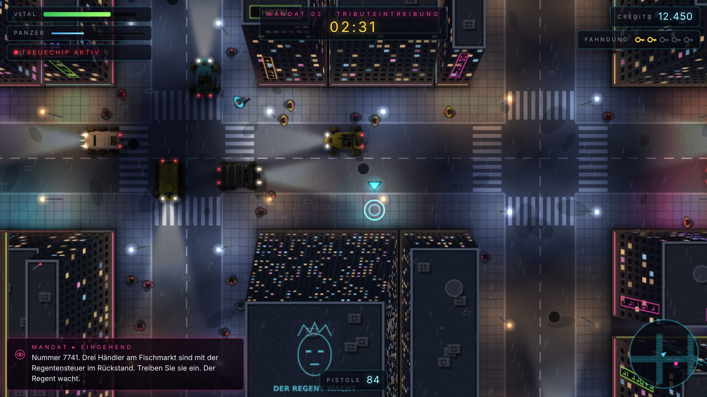
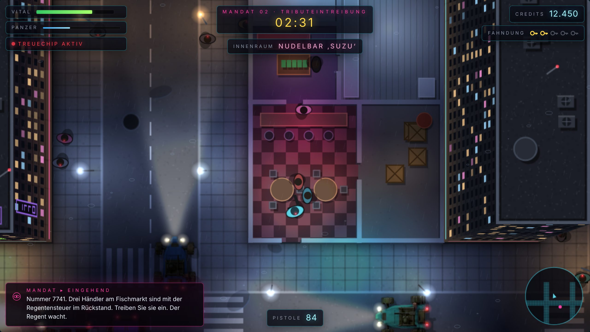

# NEON REGENT – Umsetzungsplan

> **Arbeitstitel.** Ein Top-down-Open-World-Spiel im Stil von GTA 2, gebaut auf der Technik
> und dem Look von **IRONCLAD** (`ironclad.html`), in einer Cyberpunk-Stadt bei Nacht.
>
> Dieser Plan ist die Arbeitsgrundlage für **mehrere** Umsetzungs-Sessions (je ein Meilenstein,
> mittlerer Aufwand). Stand: Repo-Commit `f6bc224` + dieser Plan.
>
> Dateien in `docs/neon-regent/`:
> - `PLAN.md` – dieses Dokument: Regeln, Architektur, Render-Pipeline, Sound-Design, Meilensteine, Tests
> - `WORLD.md` – Stadtplan (ASCII), Landmarken, Innenraum-Typen, alle Tuning-Tabellen
> - `STORY.md` – Story-Bibel, Wendung, alle 15 Missionen als Daten, alle Spieltexte
> - `concept.html` + `concept.jpg` / `concept-innen.jpg` – **validierter Konzept-Render**: Ziel-Look und Referenzcode für
>   kippende Gebäude, Nacht-Lightmap und begehbare Gebäude (Dach weg, Grundriss). `concept.html#inside` zeigt den Innenraum,
>   `#enter` das Hinein- und Hinausgehen, `#cut50` den Übergang. Läuft direkt im Browser (auch file://).
> - `klangprobe.html` – **Referenz-Rezepte für den Sound** (Überfahren, Panik, Vollstreckung, MANDAT); spielt alles live im
>   Browser ab, lädt das Aufnahmen-Bundle und nimmt eigene Dateien per Drag & Drop an.
> - `AUFNAHMEN.md` – **Takeliste und Anleitung für die Aufnahmen** (Schreie, Stöhnen, Rufe), Lizenzregeln, Packen mit
>   `tools/sound-packer/pack.py`.

| Straße bei Nacht (`concept.jpg`) | Begehbares Gebäude, Dach weg (`concept-innen.jpg`) |
|---|---|
|  |  |

---

## 0. So arbeitest du mit diesem Plan (für die umsetzende Session)

1. Lies **§0–§5 und §8–§10 vollständig**, bevor du Code schreibst. Lies `concept.html` (≈ 700 Zeilen) und
   `klangprobe.html` (≈ 310 Zeilen) – das ist funktionierender Referenzcode für Gebäude, Licht, Innenräume und Sound.
2. Schau in **§14 Fortschrittslog**, welcher Meilenstein als Nächstes dran ist.
3. Lies die für diesen Meilenstein genannten Abschnitte in `WORLD.md` / `STORY.md` (steht bei jedem Meilenstein).
4. Setze **genau einen Meilenstein** um (MS0 + MS1 zusammen ist ok, wenn Zeit bleibt). Danach **stoppen**.
5. Teste nach §9, trage Ergebnis/Abweichungen in §14 ein, committe (`Neon Regent MSx: …`) und pushe.
6. Berichte: was fertig ist, Screenshots, Messwerte, was der Nutzer entscheiden muss.

### Harte Regeln

| # | Regel | Warum |
|---|---|---|
| R1 | `ironclad.html`, `underworks.html` und die XFire-Dateien **nicht ändern** – Ausnahmen: Menü-Links (`index.html`, `ironclad.html`) und ein README-Abschnitt. | Die anderen Spiele dürfen nicht kaputtgehen. |
| R2 | **Kein Build-Schritt, keine Laufzeit-npm-Abhängigkeiten, keine ES-Module.** Klassische `<script src="…?v=…">`-Tags. | Das Spiel muss wie Ironclad von `file://` und GitHub Pages laufen (ES-Module scheitern an file://-CORS). |
| R3 | Laufzeit nur **Canvas 2D**. three.js nur offline im Asset-Baker. | Konsistent mit Ironclad, kein WebGL-Risiko. |
| R4 | Jede JS-Datei ≤ ~1500 Zeilen; sonst teilen. | Editierbarkeit für spätere Sessions. |
| R5 | Alle Tuning-Zahlen in `C.*` (00-core.js) oder Datentabellen (04-data.js), nie verstreut. | Balancing ohne Suchen. |
| R6 | Alle sichtbaren Texte **Deutsch**, zentral in `13-story.js` (`STR`, `MISSIONS`). | Eine Stelle für Sprache/Story. |
| R7 | **Keine GTA-Inhalte**: keine Namen, Karten, Missionen, Musik, Logos aus GTA. Nur Genre-Mechaniken (Fahndung, Autos klauen, Missionen). | Eigenständiges Spiel, keine Kopie. |
| R8 | Performance messen wie §10 (rAF-Intervall im headless Chromium), nicht schätzen. | Siehe Messfallen in §10. |
| R9 | Wenn der Plan falsch/unklar ist: pragmatisch entscheiden, **Abweichung in §14 dokumentieren**, weitermachen. | Nicht blockieren. |
| R10 | Code aus Ironclad/Underworks **kopieren und anpassen**, nicht die Originale für Wiederverwendung umbauen. | R1. |
| R11 | Jede Spielfigur/jedes Fahrzeug braucht **prozedurale Fallback-Grafik** (wie `VEHICLE_ART` in Ironclad). Das Spiel muss ohne Sprite-Bundle laufen. | Fortschritt vor dem Baken, Robustheit. |
| R12 | Canvas-Fonts immer mit generischem Ende: `"Arial Black", "Arial Bold", Verdana, "DejaVu Sans", sans-serif`. | Im Konzept fiel Text unter Linux auf Serif zurück. |
| R13 | **Sound ist gleichrangig mit Grafik.** Jeder Meilenstein liefert die Klänge seiner Features mit (steht in jeder DoD); kein Feature gilt ohne Sound als fertig. Rezepte: `klangprobe.html`; **menschliche Laute sind Aufnahmen** (`AUFNAHMEN.md`). | Nutzer-Vorgabe: „Sounds sind besonders wichtig." |
| R16 | **Keine Audiodatei ohne Lizenzzeile.** Aufnahmen kommen nur über `tools/sound-packer/pack.py` ins Spiel (Lizenzsperre: CC0, Public Domain, eigene Aufnahme mit Einverständnis). | Öffentliches Repo verteilt die Dateien. |
| R14 | Meilensteine heißen **MS0–MS12**, Missionen **M00–M14**. In Commits, Log und Berichten nie verwechseln. | „M10" war sonst doppelt belegt. |
| R15 | Die Session kann nicht hören. Klänge werden **automatisch geprüft** (Pegel, NaN, Clipping, §9) und als **WAV an den Nutzer** gegeben; sein Urteil zählt. | Sonst bleibt Sound ungeprüft. |

---

## 1. Das Spiel in fünf Sätzen

**NEON REGENT** spielt in **HALOGEN**, einer verregneten Neon-Stadt 41 Jahre nach dem **Feuertag**, dem Atomkrieg, der die Welt
draußen zur Wüste gemacht hat (die Ödnis aus IRONCLAD). Als **Nummer 7741** erfüllst du die **Mandate** von **MANDAT**, der KI
des Regenten – scheiterst du, tötet dich der **Treuechip** in deinem Nacken. Du fährst und läufst frei durch drei Distrikte,
klaust Autos, und wer Passanten überfährt, hat den **Ordnungsdienst** am Hals – die Fahndung eskaliert von Streifen bis zu Panzern.
Nach und nach zeigt sich: Den Regenten gibt es seit dem Feuertag nicht mehr; MANDAT gehört der Bande **DIE ERBEN**.
Im Finale zerschlägst du alle fünf Anführer der Erben und ihr Versteck im Bunker unter dem Regentenpalast – und siehst den
ersten Morgen ohne Herrscher.

**Look in einem Satz:** *Ironclad bei Nacht* – dieselben gebackenen 3D-Sprites (16 Ansichten, Lackmaske), dieselben
Explosionen/Glows/Brandflecken/Screen-Shake und HUD-Karten, aber mit Nacht-Lightmap, Neon, Regen und kippenden
Gebäuden im GTA-2-Stil. Das Morgengrauen im Finale bringt Ironclads warme Wüstenpalette zurück.

**Zwei Säulen, die der Nutzer ausdrücklich betont hat:**
- **Sound:** Die Stadt muss sich so lebendig anhören, wie sie aussieht – Regen, Motoren, Sirenen, Neon-Summen und vor allem
  **Menschen**: Wer überfahren wird, schreit (Angstschrei, der beim Aufprall abreißt; Aufprall; Achsen-Doppelschlag),
  Umstehende schreien und fliehen, Verletzte stöhnen am Boden (§4.10). Menschliche Laute sind **Aufnahmen** – synthetische
  Schreie klangen im Test künstlich (Nutzer-Urteil); alles andere bleibt synthetisch (`klangprobe.html`, `AUFNAHMEN.md`).
- **Begehbare Gebäude:** Rund **10 % der Gebäude** kann man betreten. Dann verschwindet das Dach, und man sieht von oben in den
  Grundriss – Räume, Wände, Möbel, Menschen und die eigene Figur (§5.9, `concept-innen.jpg`).

---

## 2. Entscheidungen

Die mit **offen** markierten Punkte sind Vorschläge – der Nutzer sollte sie vor MS8 (Missionen) bestätigen.
Technische Punkte (fix) sind durch den Konzept-Render belegt.

| # | Thema | Entscheidung (Default) | Alternative | Status |
|---|---|---|---|---|
| D1 | Namen | NEON REGENT · Stadt HALOGEN · KI MANDAT · Bande DIE ERBEN (siehe STORY.md) | eigene Namen | **offen** |
| D2 | „Wer scheitert, wird getötet" | Treuechip vollstreckt (Sequenz, 3,5 s) → **Mandat wiederholen** ab Missionsstart. Kein Permadeath. | Spielstand-Verlust | **offen** |
| D3 | „Eine Art Polizei" | **Ordnungsdienst (OD)** = Tarnorganisation der Erben. Erklärt Polizei ohne Herrscher, macht Akt III konsequent. | neutrale Automaten-Polizei | **offen** |
| D4 | Zeitpunkt der Enthüllung | Ende Akt II (Mission 10 von 15, ≈ 2/3). Danach Akt III „Abrechnung" = Finale-Bogen. | erst direkt vor dem Finale; Finale = eine lange Mehrphasen-Mission | **offen** |
| D5 | „Alle aus der Bande zerstören" | Die **5 Anführer** (4 Leutnants frei wählbar + der Notar) samt Crews in ihren Missionen, dann das Versteck. | jeder Erbe stadtweit zählbar | **offen** |
| D6 | Plattform | Desktop (Tastatur/Maus) + Gamepad zuerst; **Touch erst in MS12**. Input-Abstraktion von Anfang an. | Touch ab MS2 | **offen** |
| D7 | Sprache | Deutsch | Englisch/zweisprachig | **offen** |
| D8 | Technik | Multi-File (klassische Scripts), Canvas 2D, **Lightmap (½ Auflösung, multiply)**, kippende Gebäude per affiner Fassaden-Transformation | Single-File; WebGL | fix (gemessen) |
| D9 | Tageszeit | Immer Nacht + Regen; **Morgengrauen nur im Ende** | Tag/Nacht-Zyklus | fix (Story) |
| D10 | Gewalt | Stilisiert (dunkle Splats, keine Zerstückelung); Option „Blut aus" | – | fix |
| D11 | Auto-Steuerung Tastatur | „Klassisch" (W/S Gas/Bremse, A/D lenken, fahrzeugrelativ); Option „Direkt" (bildschirmrelativ wie Ironclads Panzer). Stick/Touch: Default „Direkt". | – | fix |
| D12 | Begehbare Gebäude | **10 %** der normalen Gebäude + alle Dienste (Kapselhotel, Waffenhändler, Klinik, OD-Wache, Kopfgeld-Büro) + Story-Orte (Untergrundklinik, Klinik Null, Mausoleum). Beim Betreten: Dach weg, Grundriss von oben, Kamera zoomt hinein. Nur Erdgeschoss. | mehrere Stockwerke | **Nutzer-Vorgabe** (im Konzept validiert) |
| D13 | Klangquelle | **Entschieden (Nutzer, 2026-11-26): menschliche Laute = Aufnahmen**, alles andere synthetisch (`klangprobe.html`). Die synthetische Stimme bleibt nur Rückfall. **Quelle vorerst B (CC0):** 91 Takes von Freesound im Bundle (§6.4, Nutzer-Anweisung „im Notfall nimm die Schreie"). Lücken (Spielfigur, Rufe von Frauen) per Weg A ergänzen; einzelne Takes jederzeit ersetzbar (`AUFNAHMEN.md`) | alles synthetisch (abgelehnt: „klingt synthetisch") | **entschieden** (Quelle CC0, ergänzbar) |
| D14 | Sprache der Rufe | **Englisch** (Nutzer, 2026-11-26: „Stimmen können englisch sein"). In der Welt: internationale Megastadt. Bildschirmtexte, Pager und MANDAT bleiben deutsch. Regel: alle gesprochenen Wörter in **einer** Sprache – eigene Aufnahmen später auch englisch (oder wortlos) | Deutsch (frei praktisch nicht zu bekommen) | **entschieden** |

---

## 3. Was aus dem Repo übernommen wird (Reuse-Map)

Zeilennummern = Stand `f6bc224` (können sich verschieben; Funktionsnamen sind maßgeblich).

### 3.1 `ironclad.html` (Hauptquelle)

| Was | Wo (Zeile) | Verwendung in NEON REGENT |
|---|---|---|
| CSS-Tokens, HUD-Karten, Banner, Callout, Overlays, Buttons | 12–396, Markup 400–500 | Basis für HUD/Menüs. Palette auf Neon umstellen (WORLD.md §12). |
| `fitCanvas` | 539–553 | Canvas-Skalierung + HUD über Canvas legen. Mit Underworks' Render-Scale kombinieren (optional). |
| Mathe-Helfer (`rand`, `angDiff`, `angleLerp`, `weighted` …) | 559–582 | 1:1, plus seeded RNG (siehe concept.html `rnd`). |
| `Snd` (Synth-Engine, Abstand/Panning, Gates) + `SFX` | 585–795 | Basis-Audio. Neue Rezepte siehe WORLD.md §13. |
| `Music` (Step-Sequencer mit Intensitäts-Layern) | 797–866 | Synthwave-Variante; Intensität = Fahndung/Kampf. |
| Input Tastatur/Maus, Touch-Twin-Sticks, Fullscreen | 868–949 | In Input-Abstraktion (§4.9) einbauen. |
| Sprite-Cache `sprite`, `tinted`, `glowSprite`, `lightSprite`, `smokeSprite`, `shadowSprite`, `scorchSprite` | 951–1082 | 1:1. |
| `VEHICLE_ART` (prozedurale Draufsicht-Fahrzeuge) | 1124–1302 | Vorlage für prozedurale Fallback-Autos/-Peds (R11). |
| Sprite-Pack: `loadPack`, `packSheet`, `packDir`, `drawPack`, `drawPackTint` | 1382–1486 | 1:1, Namespace `NEONREGENT_ASSETS` statt `IRONCLAD_ASSETS`; Erweiterung um `frames` (Zeilen) und `emitters`. |
| Icons `drawIcon`, `pickupSprite` | 1488–1556 | Power-up-Kisten (WORLD.md §7). |
| `POWERUPS`, `ENEMIES`, Squads | 1561–1611 | Vorlage für Datentabellen. |
| `buildDesert`: Rausch-Techniken (Tonflecken, Streuung) | 1616–1751 | Vorlage für prozedurale Boden-Kacheln. |
| Flow-Field (`buildFlowGrid`, `updateFlow`, `flowAngle`) | 1804–1855 | Fußgänger-KI von OD/Erben im Fenster um den Spieler (§4.8). |
| `hasLOS`, `collideRocks` | 1875–1911 | Ersetzen durch Kachel-DDA + AABB-Kollision (§4.7), Logik übernehmen. |
| Partikel `part`, `glow`, `light`, `smoke`, `sparks`, **`explosion`**, `stampScorch`, `muzzleFlash`, `floatText` | 1943–2046 | **1:1** – das ist der Ironclad-Look. `stampScorch` schreibt in Boden-Chunks (§5.4). |
| `blast`, `damageEnemy`, `damagePlayer`, `killPlayer` | 2048–2118 | Schadensmodell, auf Peds/Fahrzeuge/Props verallgemeinern. |
| `updatePlayer` (Panzer-Fahrmodell, Zielhilfe Touch, Rammen) | 2128–2248 | Fahrmodell für den **Tribunal-Panzer**; Zielhilfe (Aim-Assist) für Stick/Touch. |
| Waffen `fireCannon`, `fireLaser`, `fireRockets`, `updateDrones` | 2263–2375 | Panzerkanone, Schienengewehr, Raketen, Kampfdrohnen-Power-up. |
| Pickups `spawnPickup`, `applyPickup`, `updatePickups` | 2376–2457 | Power-up-/Waffenkisten. |
| Gegner: `makeEnemy`, `enemyShot`, `enemyRocket`, `avoidRocks`, **`huntAngle`** (Sicht, letzte Position, Suchen), **`updateEnemies`** (KI-Typen ram/circle/bomb/charge/shoot/snipe/mortar/mine/rocket/heli) | 2459–2802 | KI-Bausteine für OD, Erben, Drohnen, Gunship (WORLD.md §8). |
| **`updateBoss`** (4 Muster, Enrage bei 50 %) | 2803–2871 | Bosse Vollstrecker und Notar. |
| `killEnemy`, `settleWreck`, `updateWrecks`, `updateBullets` | 2889–3148 | Tod, Wracks (verkohlte Hülle bleibt), Projektile. |
| `updateCamera` (Lead, Zoom-Punch), `onScreen` | 3299–3326 | Kamera; Zoom abhängig vom Tempo (§4.4). |
| `buildOverlays` (Vignette), `render` (Reihenfolge, additiver Pass), `drawLights`, `drawBullets`, `drawBeams`, `drawTelegraphs`, `drawTexts`, `drawIndicators` (Randpfeile), `drawRadar` | 3328–3980 | Grundgerüst; Reihenfolge wird erweitert (§5.1). |
| `updateHud`, `showBanner`, `showCallout` | 4008–4057 | HUD-Logik. |
| Loop `step`, `frame`, **`adaptQuality`** | 4059–4133 | Fixer 60-Hz-Takt (max. 4 Ticks/Frame), Qualitätsanpassung. |
| `startGame`, `gameOver`, `togglePause`, Boot | 4149–4224 | Zustandswechsel. |

### 3.2 `underworks.html`

| Was | Wo | Verwendung |
|---|---|---|
| Render-Scale/`fitCanvas` (Device-Auflösung, ganzzahlig) | 398–430 | Optional ab MS12 für HiDPI. |
| `toggleFullscreen` | 430–433 | Fullscreen-Button, Alt+Enter. |
| **Gamepad**: `pollPads`, `rumble`, `padMenuNav` | 1360–1450 | Gamepad in MS12 (Menü-Navigation inkl.). |
| `THEMES` mit Farb-Grade | 2069–2076 | Idee für Distrikt-Stimmung (bei uns: Lightmap-Umgebungsfarbe). |
| `renderLighting` (Dunkelheit + Löcher, Lichtliste mit Flackern/Blinken, dynamische Lichter) | 5838–5880 | **Nur als Ideenquelle** für die Lichtliste. Ersetzt durch die Lightmap (§5.3) – gemessen 2–3× günstiger. |
| Post: Vignette, Scanlines | 5605–5625, 5691 | Scanlines optional (Einstellung). |
| Intro-Overlay (Zwischensequenz) | 5886–5990 | Vorlage für Zwischensequenzen. |
| localStorage-Muster (try/catch) | 1142, 2635, 6058 | Speichern/Einstellungen. |

### 3.3 XFire (`sfx.js`, `render.js`)

| Was | Wo | Verwendung |
|---|---|---|
| Formant-Silbe | `sfx.js` 123 | Basis für Stimmen. |
| Schmerzschrei (`cry`) | `sfx.js` 308 | Passanten-Schreie. |
| Vocoder-Maschinenstimme (Series 9) | `sfx.js` 435 | **MANDAT-Stimme** (tiefer). |
| `radioVoice` (Funk-Geplapper) | `sfx.js` 479 | Vela, OD-Funk. |
| Ansager | `sfx.js` 813 | Idee für MANDAT-Durchsagen. |
| Decals (`splat`) | `render.js` 236–270 | Stil für Passanten-Splats. |
| Klangbank-Baking `bake()` (OfflineAudioContext, alle Varianten parallel) | `sfx.js` 650–672 | Muster für die Klangbank (`02b-sfx.js`). |
| `_spatial` (Panorama, Abstand, Luftdämpfung), Stimmen-Limits `SOUND_DEFS` | `sfx.js` 514–540, ~686 | Positionierung, Limits. |
| **Überfahren, Panik, Vollstreckung, MANDAT; Aufnahmen-Pfad; Schrei-Stimmmodell (Rückfall)** | `docs/neon-regent/klangprobe.html` | **1:1** übernehmen: `runOver`, `panic`, `execution`, `mandatCall`, `nearMiss`, `playRec`/`recPool`/`pickRec`/`VOICE_CHAIN`/`RUF`/`loadBundle` (Aufnahmen), `scream`/`groan` (synthetischer Rückfall). |

### 3.4 Asset-Baker (`tools/asset-baker/`)

| Was | Wo | Verwendung |
|---|---|---|
| `--ironclad`-Zweig | `bake.mjs` 88–110 | Kopieren als `--neonregent`. |
| Jobliste | `ironclad-jobs.mjs` | Vorlage für `neonregent-jobs.mjs`. |
| `icCell`, `bakeTop`, `previewTop` | `lib/page.js` 127–167 | Kopieren als `nrCell`/`bakeNR`/`previewNR` + Frames + Emitter. |
| Modelle (Draufsicht, Rumpf-Halblänge 10 Einheiten, Blick nach +x, Lackflächen = `TEAM`) | `lib/ironclad.js` | Stil-Vorlage; `heli`, `tank`, `boss`, Türme **mit Stadt-Stil neu backen**. |
| Infanterie-Rig (5 Frames Laufzyklus) | `lib/infantry.js` `soldier()` | Vorlage für das Passanten-Rig. |
| Renderer (`view: 'top'`, `separateShadow`, `groundShadow`) | `lib/iso.js` | Unverändert nutzen. |
| WebP + Bundle | `pack.py` 48–79 | Abschnitt für `neonregent` ergänzen. |

---

## 4. Technische Architektur

### 4.1 Dateien und Ladereihenfolge

```
neonregent.html                 Shell: Canvas, HUD-DOM, Menüs, CSS, Script-Tags (?v=NR_VERSION)
neonregent/00-core.js           Namespace, C (Konstanten), Mathe, seeded RNG, Event-Bus, Settings/Storage-Helfer
neonregent/01-input.js          Tastatur/Maus/Gamepad/Touch → Intent-Objekt (§4.9)
neonregent/02-audio.js          Audio-Engine: Busse, Mix/Ducking, Positionierung, Verdeckung, Innen/Außen, Stimmen-Verwaltung, Loops
neonregent/02b-sfx.js           Klangrezepte (klangprobe.html + Ironclad/XFire) und Klangbank-Baking (Varianten)
neonregent/02c-music.js         Musik (Synthwave-Layer nach Fahndung/Kampf) und Autoradio
neonregent/03-sprites.js        Sprite-Cache, FX-Sprites, prozedurale Fallback-Art, Pack-Loader (NEONREGENT_ASSETS)
neonregent/04-data.js           VEHICLES, WEAPONS, POWERUPS, UNITS, PROPS, LIGHT_TYPES, HEAT, ECONOMY (aus WORLD.md)
neonregent/05-citygen.js        Zonenplan → Kacheln, Straßen/Spuren, Gehwege, Grundstücke, Gebäude, Props, Lichter, Landmarken
neonregent/06-world.js          Kachel-Abfragen, Collider-Raster, Raycast/LOS, Flow-Field, Straßengraph + A*, Spawn-Ring, Decal-Chunks
neonregent/06b-interiors.js     Begehbare Gebäude: Auswahl, Grundriss (BSP/Templates), Möbel, Innenlichter, Bewohner, Beute, Dach-weg-Zustand
neonregent/07-entities.js       Datenformen, Spatial-Hash, Spawn/Despawn, Lebenszyklus
neonregent/08-vehicles.js       Fahrphysik, Schaden, Ein-/Aussteigen/Kapern, Verkehrs-KI
neonregent/09-peds.js           Spieler zu Fuß, Passanten-KI, Fuß-KI für OD/Erben
neonregent/10-combat.js         Waffen, Projektile, Explosionen (Ironclad-FX), Pickups, Power-ups
neonregent/11-police.js         Fahndung, OD-Disposition, Eskalation, Verhaften, Chip-Wäsche
neonregent/12-missions.js       Missions-Interpreter, Schritt-Typen, Marker, Timer, Vollstreckung, Checkpoints
neonregent/13-story.js          MISSIONS (aus STORY.md), STR (alle Texte), Ticker, Datenchips, Erben-Liste
neonregent/14-render.js         Kamera, Render-Reihenfolge, Boden-Chunks, Gebäude (kippend), Fassaden/Dach-Texturen (LRU)
neonregent/15-lighting.js       Lichtregister, Lightmap, Regen, Dampf, Glitch, Post
neonregent/16-hud.js            DOM-HUD, Pager, Banner, Radar/Minimap, Vollkarte, Läden, Pause-Menü, Zwischensequenz-UI
neonregent/17-main.js           Zustandsautomat, fixer Loop, Speichern/Laden, Debug, NR_TEST, Boot
assets/sprites/neonregent.bundle.js   gebackene Sprites (optional; Fallback-Art, wenn es fehlt)
```

### 4.2 Konventionen

- Jede Datei beginnt mit `'use strict';` und einem Kopfkommentar „Exportiert: …".
- Klassische Scripts teilen den globalen Scope: **eindeutige Namen**, keine doppelten Top-level-`const`.
- Globale Objekte: `C` (Konstanten), `G` (Spielzustand, ersetzt Ironclads `game`), `STR` (Texte), Datentabellen in GROSSBUCHSTABEN.
- Zeit in **Ticks** (60/s) in der Simulation; Sekunden nur in Daten (Missionen), beim Laden umrechnen.
- Positionen in Welt-Pixeln; Kacheln = `TILE` 64 px; Zonen-Zelle = 8×8 Kacheln.
- Winkel in Radiant, 0 = +x (Osten), wie Ironclad.

### 4.3 Maßstab

Alle Zahlen stehen in `WORLD.md §1` (`C.*`). Eckwerte: Kachel 64 px, Fahrspur = 1 Kachel, Gehweg = 1 Kachel,
Limousine 70×30 px, Passant r = 7 px, Stockwerk 22 px. Karte 306 × 96 Kacheln (19 584 × 6 144 px).

### 4.4 Loop und Zustände

- Fixer Takt wie Ironclad: `acc += dt; while (acc >= TICK && n < 4) step();` dann **ein** `render()` pro rAF.
- `G.state`: `boot` → `menu` → `intro` (Zwischensequenz) ↔ `play` ↔ `paused` · `cutscene` · `dying` (Ironclad-Zeitlupe) ·
  `executed` (Vollstreckungssequenz) · `busted` · `wasted` · `missionFail` · `missionDone` · `ending` · `credits`.
- In `cutscene`/`executed` läuft die Welt weiter (Verkehr, Regen), Eingaben sind gesperrt.
- Drinnen sein ist **kein** eigener Zustand: `G.inside = gebäudeId | null` (Spiel läuft normal weiter, §5.9).
- Kamera: Zoom zu Fuß `C.ZOOM_FOOT` (1.35); im Auto `lerp(C.ZOOM_CAR_SLOW, C.ZOOM_CAR_FAST, speed/topSpeed)` (1.15 → 0.80),
  geglättet; Vorausschau = Geschwindigkeit × 22 (max 260 px) bzw. zu Fuß Ironclads Ziel-Lead (0.2 × Zielabstand).

### 4.5 Weltmodell

- **Kacheln** `G.tiles` (`Uint8Array`, 306×96): `ROAD`, `JUNCTION`, `CROSSWALK`, `SIDEWALK`, `LOT`, `BUILDING`, `WATER`, `BRIDGE`, `PARK`, `QUAY`.
- **Spurrichtung** `G.lane` (`Int8Array` dx/dy je Kachel; Rechtsverkehr, siehe WORLD.md §2.3).
- **Collider**: Liste von AABBs (Gebäude, Mauern, Props) in einem statischen Raster (128-px-Zellen → Index-Listen).
- **Gebäude**: `{x0,y0,x1,y1,h,style,seed,lm?,interior?:'ruin'|'pit'}`; `h` in px (Stockwerke × 22), `h < 0` = Grube.
- **Höhen-Props** (Laternen, Kräne, Container-Stapel): wie Gebäude mit Höhe, aber als „Mast + Kopf-Sprite" (concept.html: Laternen).
- **Landmarken** `G.lm[id] = {cells, rect, center, spots:{}}`; Missionspositionen `{lm, dx, dy}` (Kacheln relativ zum Lot-Zentrum)
  werden auf die nächste passende Kachel geschnappt (Fahrzeuge → Fahrbahn, Personen → Gehweg/Lot).
- **Straßengraph**: Knoten = Kreuzungen (2×2-JUNCTION-Blöcke) und Sackgassen-Enden; Kanten = Spursegmente mit Richtung und Länge.
  Sackgassen werden markiert (Verkehr meidet sie). A* für OD-Fahrzeuge und die Navi-Route.
- **Gehweg-Graph**: Nachbarschaft der SIDEWALK/CROSSWALK-Kacheln (Passanten).
- **Spatial-Hash** für dynamische Entitäten (128-px-Zellen, jeden Tick neu).
- **Flow-Field** (Ironclad) auf 32-px-Raster in einem 64×64-Zellen-Fenster um den Spieler, alle 15 Ticks.
- **Begehbare Gebäude** (§5.9): `b.enterable = true` (10 % + Dienste + Story-Orte). `b.interior` wird **lazy** erzeugt, sobald der
  Spieler < 900 px herankommt (deterministisch aus `seed`): `{ kind, rooms, doors, walls, floor, lights, npcs, loot, entrance }`.
  Statt des soliden Grundriss-Colliders bekommt ein begehbares Gebäude Außenwände als dünne AABBs mit Türlücke.
  Missionspositionen innerhalb eines begehbaren Gebäudes bleiben drinnen (Innenboden) statt herausgeschnappt zu werden.
- **Decal-Chunks**: Boden in 512-px-Chunks, LRU-Cache; Decals (Brandflecken, Splats, Bremsspuren) werden in den Chunk
  gestempelt **und** pro Chunk als Liste gespeichert (max. 40), damit ein neu erzeugter Chunk sie wieder bekommt.

### 4.6 Entitäten (Datenformen)

```js
ped     = { id, kind:'ped', type, x, y, vx, vy, a, r:7, hp, maxHp, ai, state, tag?, team:'civ'|'od'|'erbe'|'ally'|'player',
            weapon?, ammo?, frame, anim, panic, down, inCar:null, chipOn:true, coat:'#…', sees, lastSeen,
            voice:{ type:'mann'|'frau'|'alt'|'jung', seed, peak }, inside: gebäudeId|null }
vehicle = { id, kind:'veh', cls, x, y, vx, vy, a, w (Winkelgeschw.), hp, maxHp, paint, driver:pedId|null, team,
            ai, lane, target, boost, burning, lights:{head, brake, siren}, tag? }
prop    = { id, kind:'prop', type, x, y, hp?, collider, tag?, solid:true }
pickup  = { id, kind:'pick', type, x, y, life, bob }
light   = { x, y, r, color, k, type, angle? }   // jedes Frame neu gesammelt (§5.3)
```

### 4.7 Physik

**Fahrzeuge** (Arcade, pro Tick; Parameter je Klasse in WORLD.md §5):

```
f = (cos a, sin a), r = (−sin a, cos a)
vf = v·f ; vr = v·r
vf += throttle * accel   (rückwärts: × 0.45, max 0.4 × top)
vf *= (1 − drag)         ; bremsen: vf → 0 mit brake
vr *= (1 − grip)         ; Handbremse: grip × 0.15 (Drift), Bremsspuren wenn |vr| > 1.4
w   = steer * steerRate * clamp(|vf| / 3, 0, 1) * sign(vf)
a  += w ; v = f*vf + r*vr ; Position += v
```

- Kollisionsform Auto: 3 Kreise entlang der Längsachse (Radius = Breite/2). Gegen AABBs herausschieben; Normalanteil
  der Geschwindigkeit × −0.3 (Restitution); Drehimpuls aus Hebelarm des Kontakts. Schaden = max(0, vN − 2)² × 2.
- Auto–Auto: Kreis-Kreis zwischen den Kreis-Sets, Impuls nach Masse, Schaden beidseitig.
- **Auto–Passant**: relative Normalgeschwindigkeit > 2.5 px/Tick → Treffer: Schaden = (v − 2) × 12; sonst Umschubsen
  (Passant fällt, steht nach 1.5 s auf). Getötet → Splat-Decal, Schrei, **Fahndung** (WORLD.md §9).
- Zustand: < 60 % HP grauer Rauch, < 30 % schwarzer Rauch + Feuerlicht, 0 → brennt 4 s → Ironclad-`explosion` (Größe je Klasse) → Wrack.
- **Panzer (Tribunal)** nutzt Ironclads Panzer-Fahrmodell (bildschirmrelativ, Turm zielt auf Maus) und zerquetscht Autos.
- **Gleiter** (Schwebeauto): grip 0.12, kein Bremsspur-Decal, leichtes Schweben (Sprite-Bob).

**Zu Fuß**: Ironclad-Inertia (`v += (ziel − v) × 0.2`), Kreis gegen AABBs, Sprint mit Ausdauer, Ausweichrolle (0.35 s, i-Frames, 1 s Cooldown).

**Innenräume**: Wände sind dünne AABBs (6 px) im Collider-Raster; Türen 28 px (innen) / 32 px (Eingang) lassen nur Personen durch,
Autos passen nicht. Projektile prüfen Segment-gegen-AABB mit der Wandliste des Gebäudes (Kachel-DDA ist für dünne Wände zu grob).

### 4.8 KI

| Wer | Basis | Verhalten |
|---|---|---|
| Passanten | neu | Gehweg-Graph-Wanderung mit Schwung; an Zebrastreifen 30 % Querung, wenn kein Auto < 150 px; **Panik** bei Schuss (< 400 px), Explosion (< 600 px), Unfall (< 200 px), Leiche (< 150 px): fliehen 6–10 s mit `PED_FLEE`, dürfen auf die Straße; Panik steckt Nachbarn < 120 px an. Punks wehren sich (Ironclad `charge`). |
| Verkehr | neu | Spur-Zentren folgen; an Kreuzung Ausfahrt wählen (geradeaus 60 / rechts 25 / links 15 %, keine Sackgassen); Vorausschau-Strahl 70–120 px → bremsen; nach 2 s blockiert hupen; > 6 s blockiert und außer Sicht → despawnen; im Bild → seitlich ausweichen. Nach Rempler durch Spieler: 70 % stoppen + hupen, 20 % flüchten, 10 % aggressiv (10 s rammen). |
| OD zu Fuß | Ironclad `huntAngle` + `shoot`, neu `arrest` | Stufe 1: auf Spieler zulaufen, festnehmen (WORLD.md §9); ab Stufe 2 schießen (ideal 270 px, seitlich ausweichen). Sicht per Kachel-DDA. |
| OD-Fahrzeuge | Ironclad `ram` + Straßengraph-A* | Verfolgen über A* (alle 60 Ticks neu), nahe (< 400 px, Sicht) direkt rammen; einkesseln; Insassen steigen aus, wenn Spieler steht. Straßensperren ab Stufe 3 (§7.6). |
| Drohnen | Ironclad `heli` (vereinfacht) | fliegen über Dächer, halten Sicht (Suchscheinwerfer = Licht), leichte Schüsse; Zielerfasser-Drohne = Ironclad `snipe` (Laser-Telegraph). |
| Gunship | Ironclad `heli` | wie Ironclad, HP × 2. |
| Tribunal-Panzer | Ironclad `shoot` mit Kanone | Stufe 5; Boss-Variante nutzt `updateBoss`. |
| Erben | Ironclad `shoot`/`charge`/`circle` | ab Akt III bei Sicht feindlich; Garde mit Schrotflinte. |
| Bosse | Ironclad `updateBoss` | Muster je Boss (STORY.md), Enrage-Schwelle konfigurierbar. |
| Verbündete (`ally`) | neu, einfach | folgen Spieler/Missionspunkt, schießen auf Feinde in Sicht. |
| Bewohner (Innenräume) | neu | sitzen/arbeiten/stehen; bei gezogener Waffe oder Schuss: Schrei + Flucht durch die Tür; Ladenbesitzer bleiben; Erben-Verstecke feindlich. Navigation drinnen auf 16-px-Raster nur über den Grundriss. |
| OD im Haus | Ironclad `huntAngle` | ab Fahndungsstufe 2 folgen Fußstreifen nach 3–6 s durch die Tür; Fahrzeuge warten draußen. |

### 4.9 Eingabe (Intent-Abstraktion)

Spiellogik liest **nur** `G.in` (pro Tick aus allen Geräten zusammengeführt):

```js
G.in = { mx, my,               // Bewegung/Lenken (−1..1), bildschirmrelativ
         throttle, brake, steer,// Auto „Klassisch"
         ax, ay, aimMode,       // Zielrichtung/-punkt; 'mouse' | 'stick' | 'none'
         fire, alt, sprint, boost, handbrake, horn,
         enterP, interactP, dodgeP, weaponNextP, weaponPrevP, mapP, pauseP,   // P = Flanke (nur 1 Tick)
         weaponSlot }           // 1–8 oder 0
```

| Aktion | Tastatur/Maus | Gamepad (Standard-Mapping) | Touch (MS12) |
|---|---|---|---|
| Laufen / Lenken | WASD | linker Stick | linker Stick |
| Gas / Bremse (Auto) | W / S | R2 / L2 | Stick-Auslenkung |
| Zielen / Feuern | Maus / LMB | rechter Stick / R2 (zu Fuß), R1 (Drive-by) | rechter Stick (feuert beim Halten, Aim-Assist) |
| Sekundär (EMP/Nahkampf) | RMB | □ / X | Knopf |
| Ein-/Aussteigen, Kapern | F | △ / Y | Knopf EIN/AUS |
| Interagieren, Text weiter | E / Enter | ✕ / A (zu Fuß) | Kontextknopf |
| Handbremse / Ausweichrolle | Leertaste | ○ / B | Knopf |
| Sprint / Boost | Shift | ✕ / A (Auto: Boost) | Stick am Rand (wie Ironclad) |
| Waffe wechseln | Mausrad, 1–8, Q (letzte) | R1/L1 (zu Fuß) | Knopf |
| Hupe | H | L3 | – |
| Karte | Tab | Steuerkreuz ↑ | Knopf |
| Radiosender (MS12) | C | Steuerkreuz ←/→ | – |
| Pause | P / Esc | OPTIONS | Knopf |
| Ton aus · Hilfe · Vollbild | M · F1 · Alt+Enter | – | Knopf |

### 4.10 Sound-Design (Kernsäule)

Referenz: **`klangprobe.html`** (Stimmmodell, Überfahren, Panik, Vollstreckung, MANDAT – dort live anhörbar). Wie in XFire wird
**jeder Klang beim Laden einmal offline synthetisiert** (OfflineAudioContext, mehrere Varianten pro Klang, im Hintergrund,
Ziel ≤ 3 s) und dann aus der Bank abgespielt. Pro Frame wird nichts synthetisiert außer den Loops (Motor, Regen, Sirene).

**Signalfluss**

```
Quelle → Kategorie-Bus → [Innen/Außen-Filter] → Master → Kompressor/Limiter → Ausgang
Busse: sfx · stimmen (Schreie, Stöhnen, MANDAT, Vela) · ambience · musik · ui
Hall-Sends: Straße (1.6 s, frühe Fassaden-Reflexionen) · Raum (0.4 s) · Mausoleum (2.8 s)
```

- Lautstärke je Bus in den Einstellungen (Musik, Effekte, Stimmen, Ambiente).
- **Ducking**: tödlicher Treffer, Explosion ≥ 1.6, MANDAT-Ansage → Musik −6 dB für 1 s; MANDAT-Ansage → Ambiente −4 dB.
- **Positionierung** (XFire `_spatial`): Panorama nach Bildschirm-x, Abstand zum Kamerazentrum (rausgezoomt = weiter weg),
  Luftdämpfung (Tiefpass sinkt mit Abstand). **Verdeckung**: liegt ein Gebäude zwischen Hörer und Quelle (Kachel-DDA),
  dann −6 dB und Tiefpass 1.2 kHz.
- **Innen/Außen**: Ist der Spieler drinnen, laufen sfx/ambience von draußen durch Tiefpass 900 Hz und −8 dB, Quellen im selben
  Gebäude bekommen Raumhall. Von draußen hört man Innenräume gedämpft (Bar-Musik als dumpfer Bass an der Tür).
- **Stimmen-Verwaltung**: Priorität Spieler > Mission > Schreie > Waffen > Fahrzeuge > Ambiente. Limits: Schreie 4, Schüsse 8,
  Explosionen 4 (Ironclad-Budget), Motoren 3, Sirenen 2, gesamt 32. Bei Überlauf wird die leiseste/entfernteste Stimme beendet.
- **Varianten statt Wiederholung**: ≥ 5 Varianten je häufigem Klang, Round-Robin + Tonhöhen-Streuung ±4 %.

**Schreie und Überfahren (Herzstück)**

| Ereignis | Klang | Regeln |
|---|---|---|
| Auto rast auf eine Person zu (Tempo > 5, Zeit bis Aufprall < 0.6 s, < 140 px) | **Angstschrei** + Hechtsprung zur Seite | jede Person hat einen festen Stimm-Seed (Typ `mann`/`frau`/`alt`/`jung`, Tonhöhe) – sie klingt immer gleich |
| Tödlich überfahren | Angstschrei **reißt im Aufprall ab** · Masse-Schlag 62→30 Hz + **Punch 190→85 Hz** (hörbar auf Handys) · Körper (Bandpass 750 Hz) · Knacken · **Achsen-Doppelschlag** (Vorder-, Hinterachse) · nasser Splat · Bremsenquietschen | Musik-Ducking; Shake wie Ironclad |
| Angefahren, überlebt | Aufprall · Abrollen (3 Schläge, Schleifen) · Schmerzschrei (kurz, tiefer) · **Stöhnen** am Boden alle 2–4 s, bis die Person aufsteht | |
| Umstehende (< 300 px) | 30–60 % schreien zeitversetzt (0.4–1.6 s), **entfernt** (−10 dB, Tiefpass 1.8–3 kHz, viel Hall), dann Laufschritte | max. 3 gleichzeitig |
| Schuss oder Explosion nahe einer Menge | Panikschreie + Laufschritte | ansteckend wie die Panik-KI |
| Person brennt | langer, sehr rauer Schrei + Feuerknistern | |
| Spieler getroffen / stirbt | eigene Stimme (Schmerzlaut, Keuchen) | nie dieselbe Stimme wie Passanten |
| Vollstreckung durch den Treuechip | Summen, 3 Pieptöne, Entladung, erstickter Laut, Sturz, Tinnitus | Ambient-Vollstreckungen leiser |

**Menschliche Laute = Aufnahmen (entschieden, D13).** Schreie, Treffer-Laute, Schmerz, Stöhnen, Rufe, Brennen, Keuchen und
die Laute der Spielfigur kommen aus dem Bundle `assets/sound/neonregent.sound.js` (Takeliste und Quellen: `AUFNAHMEN.md`,
Packen: §6.4). Laufzeit wie in `klangprobe.html` (`loadBundle`, `recPool`, `playRec`): Bundle beim Laden dekodieren
(`decodeAudioData`), nach Kategorie und Sprecher ordnen; jede Person bekommt beim Spawnen einen Sprecher passend zu ihrem
Stimmtyp (`m*`, `f*`, `a*`, `j*`) **aus den Sprechern mit `angst`-Takes** und behält ihn. Pro Ereignis ein Take dieses
Sprechers; hat er die Kategorie nicht, ein Take **gleichen Geschlechts** (erst die Kategorie, dann ihr Rückfall `angst` für
`treffer`, `schmerz`, `brennen`, `ruf`). **Stimmtyp schlägt Kategorie** (`VOICE_CHAIN` in der Klangprobe): `alt` ohne eigene
Sprecher → Männer, `jung` → Frauen; **nie das andere Geschlecht** – passt nichts, synthetischer Rückfall. Zufall nur unter
der länger nicht gespielten Hälfte des Pools (`pickRec`: keine hörbare Wiederholung), `playbackRate` 0.95–1.05.
**Todesschrei** = `angst`-Take, der im Aufprall mit 15 ms Blende abreißt. **Angefahren:** der `angst`-Take bricht im Aufprall
weich ab (90 ms – ihr bleibt die Luft weg), dann `schmerz`, dann `stoehnen` und ein schwacher Hilferuf (`helpweak`) oder ein
zweites Stöhnen (0.35–0.7 s Pause). Das Opfer behält dabei möglichst seinen Sprecher (`prefer` in `playRec`).

**Rufe (englisch, D14).** Das Wort steht im Dateinamen (`ruf_<sprecher>_<wort>[2]`); das Spiel wählt nach Lage (`RUF` in der
Klangprobe, Tabelle in `AUFNAHMEN.md` §1): Opfer sieht das Auto `no`/`nope`/`wait`/`ohno`/`uhoh` (in ~30 % statt des
Angstschreis, reißt genauso ab) · Umstehende warnen `lookout` · knapp ausgewichen `whoa`/`crap`/`whatthe`/`gasp`/`nope` ·
Zeuge nach dem Aufprall `omg`/`what`/`ohno`/`no`/`help`/`bad` (einer, verständlich: Gain 0.5, Tiefpass 5 kHz – passt als
Hörsignal zum Fahndungsanstieg) · fliehende Menge `help`/`no`/`nope`/`ohno`/`bad` (etwa jeder Vierte ruft, der Rest
schreit) · Verletzter am Boden `helpweak`. Mit Wortliste gibt es **keinen** Rückfall auf `angst`: Wer kein passendes Wort hat,
schreit (vorher, ausweichen) oder bleibt still (warnen, verletzt). Klangprobe-Szene `beinahe` zeigt Warnung, Hupe,
Ausweichen und Vorbeifahrt.

**Synthetischer Rückfall** (`scream()`/`groan()`, nur bei leerem Bundle – damit das Spiel immer Ton hat): Sägezahn mit
Tonhöhenbogen, Jitter und Drift statt Vibrato, Stimmbrüche, Subharmonische, unregelmäßige Rauheit, Sättigung, 4 Formanten,
Atemrauschen. Stimmtypen: `mann` 430–520 Hz · `frau` 760–960 Hz · `alt` 360–430 Hz · `jung` 900–1120 Hz. Nutzer-Urteil:
„klingt synthetisch" – deshalb nicht als Hauptweg.

**Weitere Klangwelt** (Liste WORLD.md §13): Motoren je Klasse, Reifen, Crash nach Aufprallstärke, Hupe, Sirenen mit Doppler,
Waffen je Typ, Einschläge je Material (Fleisch, Metall, Beton, Glas), Regen nach Intensität, Stadt-Brummen je Distrikt,
Neon-Summen, Dampf, Schritte je Untergrund, Schiebetüren, Innenraum-Atmosphären (WORLD.md §14), MANDAT-Jingle und
Maschinenstimme, Vela-Funk, Musik in Layern, Radio.

**Mischung Aufnahme + Synthese beim Überfahren:** Aufnahme (Angstschrei, reißt ab) über den synthetischen Schichten
(Masse, Punch, Körper, Knacken, Achsen-Doppelschlag, Splat, Bremse). Umstehende = Aufnahmen anderer Sprecher, entfernt
(−10 dB, Tiefpass 1.8–3 kHz, viel Hall). Wirken auch die Aufprall-Schichten zu künstlich, können sie über dieselbe Kette
durch CC0-Aufnahmen ersetzt werden (eigene Kategorie `aufprall`, Packer-Tabelle `CATS` erweitern).

### 4.11 Speichern

`localStorage['neonregent_save_v1']` (try/catch wie Underworks):

```json
{ "v": 1, "t": 0, "act": 1, "done": ["M00","M01"], "flags": {"tor1": true, "jammer": false},
  "cr": 4200, "weapons": {"pistol": 120, "smg": 300}, "armor": 0, "chips": [1, 3],
  "safehouse": "1@10,3", "erben": [], "stats": {"kills": 0, "peds": 0, "cars": 0, "busted": 0, "wasted": 0, "executed": 0, "time": 0} }
```

Autosave nach jeder Mission; manuell im Kapselhotel. `localStorage['neonregent_settings']`: Lautstärken, Shake, Qualität,
Steuerungsmodus, TTS, Blut, Scanlines, Blitz-Reduktion.

### 4.12 Debug- und Testhaken

- `?debug=1`: Overlay (rAF-ms, Entitätszahlen, Fahndungspunkte, Missionsschritt, Zelle/Kachel). Tasten: F2 Collider/Spuren,
  F3 Teleport zur Maus, F4 Gott-Modus, F5 Schritt erfüllen, F6/F7 Fahndung ±1, F8 Fahrzeugklasse spawnen (zyklisch),
  F9 Nacht/Morgengrauen, F10 Mission überspringen.
- `?mission=M05`: startet direkt in Mission M05 (setzt alle Voraussetzungs-Flags).
- `?scene=<name>`: **deterministische Testszenen** (fester Seed, `Math.random` → seeded PRNG, feste Kamera/Zeit):
  `docks_street`, `neon_crossing`, `krone_palace`, `police_l3`, `police_l5`, `mandat_call`, `execution`, `dawn`,
  `runover` (reproduzierbares Überfahren mit Umstehenden), `interior` (Spieler in einem begehbaren Gebäude).
- `?seed=7741` (Default) für den Stadtgenerator. Ablation wie im Konzept: `#nolightmap,norain,…` schaltet Passes ab.
- `window.NR_TEST = { state(), setIntent(o), frames(n), teleport(x,y), give(weapon), setHeat(n), completeStep(), mission(), perf(),
  enter(gebäudeId), interiorCheck(gebäudeId), audioWav(szene) }` – `audioWav` rendert eine Klang-Szene offline und liefert Base64-WAV.

---

## 5. Render-Pipeline (im Konzept-Render validiert)

### 5.1 Reihenfolge pro Frame

1. **Boden**: sichtbare 512-px-Chunks (Albedo, hell gemalt – die Lightmap macht die Nacht). Decals sind eingestempelt.
2. **Innenböden**: das offene Gebäude (Boden + Möbel-Textur, §5.9) und Ruinen-Böden.
3. **Bodenobjekte**: niedrige Props, Wracks, Pickups, Minen.
4. **Boden-Entitäten**: Schattenblob → Fahrzeuge → Passanten und Bewohner (Sprites aus dem Pack, sonst Fallback); danach die
   **Innenwände** des offenen Gebäudes (niedrig, kippend) – noch vor der Lightmap, damit Innenlichter sie beleuchten.
5. **Lightmap** (½ Auflösung): Umgebungsfarbe + Vignette (vorgerendert) per `copy`, dann alle Lichter additiv
   (Radial-Sprites, Scheinwerferkegel, Innenlichter × (1 − cut)), dann **einmal** `globalCompositeOperation = 'multiply'`
   hochskaliert über das Bild.
6. **Kleine additive Glows am Boden**: Scheinwerfer-/Rücklichtpunkte, Blaulicht-Kern, Treuechip-Punkte, Mündungsfeuer,
   Marker-Ring. (Vor den Gebäuden, damit Dächer sie verdecken.)
7. **Höhen-Props, die niedriger als jedes Gebäude sind** (Laternen): alle Masten, dann alle Leuchtköpfe in einem additiven Batch.
8. **Gebäude** sortiert (Höhe aufsteigend, bei gleicher Höhe weiter entfernt zuerst): sichtbare Fassaden (≤ 2), dann Dach.
   Fassaden/Dächer sind **vorkomponiert** (Nacht-Albedo + Seitenschattierung + statisches Emissive in einer Textur).
   Nur animierte Teile (Hologramm-Plakate, Laufschrift) als eigene additive Ebene. Das **offene Gebäude** mit Alpha = cut und
   abhebendem Dach; Nachbarn, deren Dach in das offene Gebäude ragt, mit Alpha 0.3 (Röntgen).
9. **Röntgen-Silhouette** des Spielers (und Missionsziele), wenn er von einem Dachüberhang verdeckt ist (cyan, 50 %).
10. **Luft**: Drohnen, Gunships (vorab nacht-getönte Sheet-Variante), Granaten/Granatwerfer-Bögen.
11. **Additiver FX-Pass** (Ironclad `drawLights`, `drawBullets`, `drawBeams`): Glows, Funken, Glut, Ringe, Tracer.
12. **Rauch** (normal geblendet, Ironclad `smokeSprite`).
13. **Regen** (Bildschirmraum-Striche + Bodenspritzer; drinnen Alpha × 0.4), Dampf aus Gullys.
14. **Marker & Texte**: schwebende Zielpfeile, Klammern um Ziele, Floating-Texts, Telegraphs (Ironclad).
15. **Bildschirmraum**: Hurt-Vignette, Glitch-Streifen, Letterbox, optionale Scanlines, Radar, Randpfeile, Touch-Sticks.
16. **DOM-HUD** (eigene Ebene über dem Canvas).

### 5.2 Kippende Gebäude (GTA-2-Perspektive)

Pro Gebäude mit Grundriss `[x0,x1]×[y0,y1]`, Höhe `h`, Mittelpunkt `B`, Kamerazentrum `C` (Welt):

```js
D = (B − C) * h * C.LEAN_K            // LEAN_K = 1/1000
if (|D| > C.LEAN_MAX * h) D *= C.LEAN_MAX * h / |D|     // LEAN_MAX = 0.65
// Dach = Grundriss verschoben um D. Sichtbare Seiten (dem Kamerazentrum zugewandt):
//   D.y > 0 → Nordseite (y0) · D.y < 0 → Südseite (y1) · D.x > 0 → Westseite (x0) · D.x < 0 → Ostseite (x1)
// Jede Seite ist ein Parallelogramm P0, P1, P1+D, P0+D → Textur exakt affin mappen:
let a = P1.x − P0.x, b = P1.y − P0.y;
if (a * D.y − b * D.x < 0) { swap(P0, P1); a = −a; b = −b; }   // keine Spiegelung
ctx.save(); ctx.transform(a / tex.width, b / tex.width, D.x / tex.height, D.y / tex.height, P0.x, P0.y);
ctx.drawImage(tex, 0, 0); ctx.restore();                         // Texturkoordinate y = 0 am Boden, y = h am Dach
ctx.drawImage(roof, x0 + D.x, y0 + D.y);
```

Regeln aus dem Konzept:
- `D` ist in **Welt-px**; der Kamera-Zoom skaliert die Neigung automatisch mit (rauszoomen = flacher, wie eine höhere Kamera).
- **Dächer verdecken**, was dahinter liegt (gewollt, GTA-Gefühl) → Röntgen-Silhouette für den Spieler (§5.1 Schritt 9).
- **Kein echter Text auf Fassaden** (Orientierung wechselt je Seite) → Pseudo-Glyphen. Lesbarer Text nur auf Dächern.
- Missionsmarker **nicht** als kippende Lichtsäule (hat nahe der Bildmitte keine Länge) → Bodenring + schwebender Pfeil.
- Laternen/Kräne: Mast als Linie von Bodenpunkt zu Bodenpunkt + D, Kopf-Sprite am Ende; Licht fällt auf den Boden unter dem Kopf.
- Das Mausoleum ist **keine Grube**, sondern ein Innenraum des Palasts (§5.9) – negative Höhen braucht es nicht.
- Ruinen (M09): Mauern als schmale Gebäude (Höhe 2–3 Stockwerke), kein Dach → Innenraum sichtbar und begehbar.

### 5.3 Lightmap (Nachtlicht)

```js
lg.globalCompositeOperation = 'copy';  lg.drawImage(lmBase, 0, 0);         // Umgebung (#2a3150) + Vignette, vorgerendert
lg.globalCompositeOperation = 'lighter';
for (const L of lights) { lg.globalAlpha = L.k; lg.drawImage(lightSprite(L.color), sx - r, sy - r, 2r, 2r); }  // ½ Auflösung
// Kegel: coneSprite rotiert (Scheinwerfer, Suchscheinwerfer)
ctx.globalCompositeOperation = 'multiply'; ctx.drawImage(lm, 0, 0, VIEW_W, VIEW_H);   // EIN Vollbild-Pass
```

- Boden-/Fahrzeug-Albedo ist „Tageshelligkeit"; das Licht macht Nacht und Farbe (Natriumlampe färbt Asphalt orange).
- Gebäude kommen **nach** der Lightmap mit Nacht-Texturen (unabhängig von Bodenlichtern; kein Licht-Leck auf Dächer).
- Lichttypen, Farben, Radien: WORLD.md §11. Lichter werden jedes Frame aus Registern gesammelt (statisch: Laternen/Neon
  pro sichtbarem Chunk vorberechnet; dynamisch: Fahrzeuge, Explosionen (`light`-Partikel), Mündungsfeuer, Feuer, Drohnen).
- Morgengrauen (Ende, F9): `lmBase` interpoliert zu `C.AMBIENT_DAWN`, Neon-Intensität → 0.2, Regen aus.
- Distrikt-Stimmung über die Umgebungsfarbe: Docks dunkler/grünlicher, Neonmeile heller/magenta, Krone kühler (WORLD.md §12).

### 5.4 Boden

- Kachel-Typen prozedural gemalt (Ironclad-Rauschtechnik): Asphalt mit Rauschen/Flicken, Mittellinie gestrichelt,
  Haltelinien + Zebrastreifen an Kreuzungen, Gullydeckel (Dampf), Pfützen (nur Fahrbahn, dezent), Bordsteinkante hell,
  Gehwegplatten, Kontaktschatten am Gebäudefuß, Kaimauern, Wasser (animiert: dunkel + wandernde Lichtreflexe in der Lightmap).
- Chunks 512 px, LRU nach Speicherbudget (Qualitätsstufe: 24–48 Chunks). Decals werden in Chunks gestempelt (§4.5).

### 5.5 Fassaden- und Dachtexturen

- Pro Gebäude 4 Fassaden + 1 Dach, **lazy** erzeugt, deterministisch aus `seed`, LRU-Budget (Pixelsumme, z. B. 24 Mpx).
- Stile: `concrete`, `glass`, `neon`, `residential` (Balkone, Wäscheleinen), `industrial` (Wellblech, wenige Fenster),
  `villa` (Krone, warmes Licht), `shack` (Slum, Blech, Feuertonnen-Licht), `container` (Wellblech, Lackmaske-Farbe).
- Fenster: Stockwerk 22 px, Fenster 9×11, zufällig beleuchtet (warm/kalt/pink), Erdgeschoss-Neonband, Neon-Blattschilder
  (Pseudo-Glyphen), Regenschlieren, Seitenschattierung eingebacken. Dachprops: Klimageräte, Wassertank, Antenne mit
  Blinklicht, Helipad, Dachschilder (lesbarer Text), **Regenten-Hologramm** auf Wahrzeichen (animiert, eigene Ebene).
- Graffiti/Plakattexte hängen vom Akt ab → beim Aktwechsel den Textur-Cache leeren (STORY.md §6).

### 5.6 Effekte

- Ironclad-FX 1:1: `explosion` (Blitz, Licht, Feuerball, Druckwelle, Funken, brennende Trümmer, Rauch, Glut, Brandfleck),
  Mündungsfeuer, Treffer-Blitz, Hit-Stop (`freeze`), Screen-Shake (`trauma`), Zoom-Punch, Zeitlupe beim Tod.
- Neu: Regen (3 Schichten), Spritzwasser beim Durchfahren von Pfützen, Dampf aus Gullys, Funkenregen bei Kollisionen,
  Glitch-Streifen (Canvas-Streifen versetzt kopieren + farbiger Versatz, 4–10 Frames) bei MANDAT-Störungen und Vollstreckung.

### 5.7 HUD (DOM, Ironclad-Kartenstil, Neon-Palette)

```
┌───────────────────────────────────────────────────────────────────────────────┐
│ [VITAL ███████░░]            ┌ MANDAT 02 · TRIBUTEINTREIBUNG ┐   [CREDITS 12.450]│
│ [PANZER ██░░░░░░]            │            02:31              │   [FAHNDUNG 🔑🔑···]│
│ [● TREUECHIP AKTIV]          └ Besuche Händler 2 von 3 ──────┘   [DOCKS]          │
│ [◈ VERBORGEN]                 [BOSS ██████████████]                               │
│                                                                                   │
│                                  (Spielwelt)                                      │
│                                                                                   │
│ ┌─ MANDAT ▸ EINGEHEND ───────────────┐   [PISTOLE · 84]           ( Radar mit   ) │
│ │ Nummer 7741. Drei Händler …        │   [FZ ███████░ · BOOST ██]  ( Straßen,    ) │
│ └────────────────────────────────────┘                             ( Navi-Route  ) │
└───────────────────────────────────────────────────────────────────────────────┘
```

- **Pager** (unten links): Sprecherfarbe MANDAT Magenta, VELA Cyan, `???` Weiß-Glitch; Schreibmaschine 45 Zeichen/s;
  bleibt 2.5 s + 0.05 s/Zeichen; Warteschlange; E/Enter überspringt.
- **Fahndung** als 5 Schlüssel-Symbole (das Erben-Wappen – Vorausdeutung); blinken, wenn ein OD dich sieht.
- **Treuechip**: AKTIV (rot pulsierend) → GESTÖRT (cyan flackernd, ab M09) → STUMM (grau, nach dem Finale).
- Banner (Ironclad `showBanner`): Distriktnamen, Akt-Titel, MANDAT ERFÜLLT, VERHAFTET, AUSGELÖSCHT, VOLLSTRECKT.
- Fahrzeugname beim Einsteigen als kleiner Banner („PFEIL · SPORTWAGEN").
- Interaktionshinweise in der Welt: „[F] Einsteigen", „[E] Terminal", „[E] Speichern".
- Pause-Menü-Reiter: FORTSETZEN · KARTE · ERBEN (ab Akt III) · ARCHIV (Datenchips) · EINSTELLUNGEN · STEUERUNG · HAUPTMENÜ.
- Läden als DOM-Panel (Waffenhändler-Liste, Chip-Wäsche-Preis, Speichern-Bestätigung).

### 5.8 Marker, Radar, Karte

- Aktives Ziel: Bodenring (pulsierend) + schwebender Pfeil im Bildschirm-Oben (wie concept.html); Zielentitäten mit Pfeil + Eckklammern.
- Off-Screen: Ironclad `drawIndicators` (Randpfeile) in Zielfarbe.
- Radar (unten rechts, Norden oben): vorgerenderte Minikarte (1 px/Kachel: Straßen, Wasser, Parks), Ausschnitt um den
  Spieler; Marker (Ziel cyan, Missionsstart magenta Auge, Läden Icons, OD rot, Erben violett); **Navi-Route** (A* über
  den Straßengraph zum Ziel, als Linie, alle 30 Ticks neu).
- Vollkarte (Tab): ganze Stadt, Legende, alle bekannten Orte, gesperrte Distrikte grau mit Schloss.

### 5.9 Begehbare Gebäude: Dach weg, Grundriss sichtbar (im Konzept validiert)

**Welche:** 10 % der normalen Gebäude (deterministisch per `seed`, gleichmäßig über die Distrikte, nie in `D`, `P`, `.`), alle
Dienste (`1`–`5`, `7`) und die Story-Orte `u`, `n`, `p` (optional `g`, `q`). Von außen erkennbar an einer **beleuchteten Tür**
(warmes Licht, kleines Türsymbol im Radar ab < 400 px).

**Grundriss** (`concept.html` → `makeInterior`): Gebäudefläche per BSP teilen (Mindestraum `C.ROOM_MIN` = 96 px, Tiefe ≤ 3).
Pro Teilung **genau eine Tür** in der Mitte des längsten gemeinsamen Wandstücks zweier angrenzender Räume – so trifft eine Tür
nie eine Querwand, und alle Räume sind verbunden. Eingangstür (32 px) in der Außenwand zur Straße. Wände = Raumkanten minus
Türlücken als dünne AABBs (6 px), zugleich Collider. Raumtypen je Gebäudetyp: WORLD.md §14. Boden und Möbel werden in **eine
Textur** gemalt (2× Auflösung für den Zoom, helle Albedo – die Lightmap macht die Stimmung). Story-Orte (Untergrundklinik,
Klinik Null, Mausoleum) nutzen **handgebaute Templates** im selben Datenformat.

**Zustand und Übergang:**
- `b.cut`: 1 = geschlossen, 0 = offen. Steht der Spieler im Grundriss → Ziel 0, sonst 1; `cut += (ziel − cut) · 0.08` pro Frame (≈ 0.4 s).
- Gleichzeitig: Kamera-Zoom → `C.ZOOM_INSIDE` (1.65), Kamera auf den Spieler, Regen-Alpha × 0.4, HUD-Karte
  „INNENRAUM · Name", Audio schaltet auf innen (§4.10). Immer nur **ein** Gebäude offen – das, in dem der Spieler ist.

**Zeichnen** (Reihenfolge §5.1): Innenboden nach dem Straßenboden; Bewohner mit den Entitäten; danach die Innenwände, aber **vor**
der Lightmap – alle Wände eines Hauses mit demselben `D` für Höhe `C.WALL_H` (24 px): erst alle Seitenflächen (dunkel `#3e434e`),
dann alle Oberkanten (hell `#aab2c0`). Niedrige Wände dürfen nach den Entitäten kommen: Ihre Fläche liegt immer auf der
Kamera-abgewandten Seite und verdeckt nur, was wirklich dahinter steht. Innenlichter gehen in die Lightmap (× (1 − cut)).
Das Gebäude selbst wird im Gebäude-Pass mit Alpha = cut gezeichnet, das Dach hebt dabei ab (Neigung × (1 + 0.5 · (1 − cut))).
Nachbarn, deren Dach über das offene Gebäude ragt, bekommen Alpha `C.XRAY_ALPHA` (0.3).

**Gemessen im Konzept** (headless, Software-Raster): drinnen 18.2 ms, Übergang 20.6 ms, draußen 19.7 ms rAF – im Budget.

**Nur Erdgeschoss.** Treppen und Obergeschosse sind ausdrücklich nicht geplant (Aufwand, Lesbarkeit von oben).

---

## 6. Asset-Pipeline (Baker)

Ziel: Fahrzeuge, Passanten und Props im **selben Renderstil wie Ironclad** (Sky-Occlusion, Shader-Verwitterung,
abgefaste Kanten), aber als Stadt-Modelle. Laufzeit lädt `assets/sprites/neonregent.bundle.js` (`window.NEONREGENT_ASSETS`).

### 6.1 Was zu bauen ist

| Datei | Inhalt |
|---|---|
| `tools/asset-baker/lib/neonregent.js` | `NR_MODELS` (Fahrzeuge, Props) im Stil von `lib/ironclad.js`: Rumpf-Halblänge 10 Einheiten, Blick nach +x, Lackflächen `TEAM`. `nrPed(kit, look, frame)`: Passanten-Rig nach `lib/infantry.js` (Looks siehe unten). Emitter-Punkte je Modell. |
| `tools/asset-baker/neonregent-jobs.mjs` | Jobliste `{ name, model, ref, scale, cell, dirs, frames, tint, shadow:false, emitters }` |
| `tools/asset-baker/lib/page.js` | `nrCell(job, dir, frame)` (wie `icCell`, plus Frames, Stil `NR_STYLE`, ohne Bodenschatten), `window.bakeNR`, `window.previewNR` |
| `tools/asset-baker/bake.mjs` | Zweig `--neonregent` (Kopie von `--ironclad`): schreibt `assets/sprites/neonregent/*.png` + `neonregent.json` (cell, dirs, frames, ref, emitters) |
| `tools/asset-baker/pack.py` | Abschnitt `neonregent` → WebP + `assets/sprites/neonregent.bundle.js` |
| `tools/asset-baker/preview.mjs` | `neonregent`-Modus wie `ironclad` (Kontaktbogen zum Prüfen) |

- `scale = ref / 10` (Modell-Halblänge 10 Einheiten = `ref` px). `ref` = Halblänge im Spiel → Skalierfaktor 1, scharf.
- **Kein gebackener Bodenschatten** (nachts nur weicher Blob, den die Laufzeit zeichnet) → spart ⅓ Bundle.
- Sheet-Layout: Spalten = 16 Richtungen, Zeilen = Frames. `drawPack` um `frame` erweitern.
- `NR_STYLE` (Startwerte, per `preview.mjs` tunen): `{ camo:[1,1,1,0], camo2:[1,1,1,0], dust:'#3d424c', dustAmt:0.25, dustH:1.5, grunge:0.35, streaks:0.45, chips:0.5, seed:41, film:0.3, panel:0.5 }`
  – nass glänzend statt staubig.
- **Emitter** (Modell-Einheiten, +x = vorne): Scheinwerfer `(9.5, ±3)`, Rücklichter `(−9.8, ±3)`, Blaulicht `(0, ±1.5)`,
  Unterboden-Neon (Farbe) – landen in `neonregent.json` und werden zur Laufzeit als Lichter/Glows gezeichnet
  (gebackene Glows würden von der Lightmap verdunkelt).

### 6.2 Modelle (Reihenfolge = Priorität)

1. **Fahrzeuge** (WORLD.md §5): Kapsel, Limo, Taxi, Pritsche, Kastenwagen, Laster (+ Container), Pfeil, Gleiter, Kurier-Bike,
   OD-Streife, OD-Abfangjäger, OD-Sturmwagen, Erben-Limousine, Sendewagen, Panzer-Ambulanz, Tresorwagen.
   **Aus `lib/ironclad.js` mit Stadt-Stil neu backen:** `heli` → OD-Gunship, `tank`+Turm → Tribunal, `boss` → Vollstrecker-Kommandopanzer.
2. **Passanten-Rig** (`nrPed`), Frames: 0 stehen, 1–4 gehen, 5 zielen (Arme vor, Pistole), 6 liegen (umgestoßen/tot).
   Looks (Lackmaske = Kleidung → Laufzeit färbt zufällig): `civ_mantel`, `civ_hoodie`, `arbeiter` (Overall, Helm), `punk` (Iro),
   `od` (Helm, Weste), `od_sturm`, `erbe` (langer Mantel, Schlüssel-Brosche), `erbe_garde`, `spieler` (Kapuzenmantel),
   `vela`, `buchhalterin`, `chirurg`, `aerztin`. Zelle 32 px logisch, `ref` 8.
3. **Props** (1 Richtung): Container, Kran-Kopf, Klimagerät, Uplink-Schüssel, Generator, Treibstofftank, Barrikade,
   Marktstand, MANDAT-Terminal, Holo-Säule, Automat, Bank, toter Baum, Holo-Baum, Poller, Mülltonne, Zellentor,
   Schildgenerator, Server-Pylon, MANDAT-Kern, Thron (mit Skelett). Ironclads `barrel`/`crate` direkt übernehmen.
4. **Notar-Mech** (Läufer, zweibeinig) – optional; Fallback: Ironclads `boss`-Modell in Erben-Farben.
5. **Möbel/Innen-Props**: zuerst prozedural in die Boden-Textur gemalt (wie im Konzept); baken nur, wenn Zeit bleibt
   (Theke, Tische, Betten, Regale, Kapseln, Serverschränke, Thron).

### 6.3 Ablauf

```
cd tools/asset-baker && npm install                       # three@0.169 (Registry ist erreichbar)
node tools/asset-baker/preview.mjs /tmp/nr.png neonregent limo od_streife --dirs 0,4,8,12
node tools/asset-baker/bake.mjs --neonregent --only limo    # erst einzeln messen, dann alles
python3 tools/asset-baker/pack.py                           # WebP + Bundle (PNG-Master sind gitignored)
```

Budget: Bundle ≤ 4 MB. Geprüft in diesem Container: Node 22, Playwright/Chromium, Pillow vorhanden; `node_modules` fehlt (→ `npm install`).

### 6.4 Aufnahmen (Sound-Bundle)

```
assets/sound/raw/<kategorie>_<sprecher>_<nr>.wav    Rohaufnahmen (WAV/FLAC/MP3/OGG), ein Take pro Datei
assets/sound/QUELLEN.md                             je Datei: Urheber, Lizenz, Quelle, Datum  (Pflicht)
pip install numpy soundfile soxr lameenc
python3 tools/sound-packer/pack.py                  → assets/sound/neonregent.sound.js (window.NEONREGENT_SOUNDS)
```

- Verarbeitung: Mono, 44.1 kHz (soxr), Stille abschneiden, Lautheit je Kategorie angleichen (RMS-Ziel, Spitze ≤ −1 dBFS),
  5/20 ms Blenden, **MP3 96 kbit/s** (Safari/iOS dekodieren OGG nicht zuverlässig), Base64 im Script (läuft von file://).
- **Lizenzsperre:** ohne Zeile in `QUELLEN.md` oder mit anderer Lizenz als CC0/Public Domain/eigene Aufnahme bricht das Skript
  ab und schreibt nichts; zu kurze oder stumme Takes ebenso.
- **Geprüft in der Planungs-Session:** Lizenzsperre greift, kaputte Takes werden abgelehnt, gutes Material wird gepackt
  (~12 KB je Take), Chromium dekodiert das Bundle, die Klangprobe spielt die Takes im Zusammenhang (Schrei reißt im Aufprall ab).
- **Stand 2026-11-26: 91 CC0-Takes** von Freesound, 48 Sprecher (30 Männer `m1`–`m30`, 18 Frauen `f1`–`f18`), 1.81 MB:
  `ruf` 23 (4 Frauen) · `treffer` 22 (4) · `angst` 18 (6) · `stoehnen` 12 (7) · `schmerz` 9 (1) · `brennen` 5 (2) ·
  `keuchen` 2 (1). Rufe englisch (D14), Dateiname `ruf_<sprecher>_<wort>[2]`. Lizenz auf der Seite jedes einzelnen Sounds
  geprüft, Ausschnitt in `QUELLEN.md`. Ausgeschlossen: Kinder oder unklares Alter, Kampf-, Comic-, Anime- und bearbeitete
  Stimmen, Sexuelles, Mitschnitte aus Film/TV, Übersteuertes, Verrauschtes. Quelle ist die HQ-Vorschau (MP3 128 kbit/s); bessere Qualität: Original
  mit Freesound-Konto laden und unter demselben Namen ersetzen.
- **Lücken:** `spieler` (Stimme der Spielfigur – Nutzerentscheidung); Rufe von Frauen nur „Help!" und zwei Aufschreie; frei
  nicht zu finden: „Run!", „Watch out!", „Call the police!"; Frauen-`schmerz` nur 1 Take; `m22` trägt 11 der 23 Rufe.
  Eigene Aufnahmen bekommen die nächsten freien Nummern (`m31`, `f19`, `a1`, `p1`).

---

## 7. Gameplay-Systeme (Spezifikation)

Zahlen stehen in WORLD.md, Missionen und Texte in STORY.md. Hier steht, **wie** die Systeme funktionieren.

### 7.1 Spieler zu Fuß
Twin-Stick (WASD bildschirmrelativ, Maus zielt). Sprint (Ausdauer 100, −0.8/Tick, +0.4/Tick), Ausweichrolle, Nahkampf (Faust),
Waffen mit Munition (kein Nachladen, wie Ironclad), Vital 100 + Panzerung 0–100 (fängt 60 % Schaden), Regeneration bis 40 %
nach 5 s ohne Treffer. Spieler hat immer ein schwaches Eigenlicht (Lesbarkeit, Konzept).

### 7.2 Fahrzeuge
- **Einsteigen/Kapern** (F, ≤ 40 px von der Fahrertür, Tempo < 2): leer → sofort; besetzt → 0.6-s-Animation, Fahrer fliegt raus,
  steht auf, flieht (Punk/Erbe/OD: kämpft). OD-Fahrzeug kapern → Fahndung (WORLD.md §9).
- **Aussteigen** jederzeit; über Tempo 6 Abrollen mit Schaden; Auto rollt aus.
- Boost (Shift) mit Anzeige (Ironclad-Boost), Hupe (H, schreckt Passanten auf), Drive-by: Pistole/MP in Mausrichtung (Streuung × 1.5).
- Bewaffnete Fahrzeuge: Tribunal (Kanone), Gunship nicht fliegbar.
- Geparkte Autos: Parkplätze `.` und Straßenränder; 30 % unverschlossen sofort, sonst 1 s „Aufbrechen" (Alarm-Hupe, Fahndung +1 bei OD-Sicht).

### 7.3 Waffen und Power-ups
Tabelle WORLD.md §6/§7. Projektile wie Ironclad (Tracer, Raketen mit Rauch, Schienen-Strahl). Flammenwerfer setzt Autos
(Brand-Timer) und Personen in Brand. EMP-Granate (Bogenwurf wie Ironclads Mörser mit Bodenring-Telegraph) legt Fahrzeuge/Drohnen
4 s lahm. Power-up-Kisten („?") wie Ironclad, feste Versteck-Orte + Drops von Bossen.

### 7.4 Passanten und 7.5 Verkehr
Spawn-Ring: zwischen 1.15× und 1.7× der halben Bilddiagonale **außerhalb** des Bildes, Despawn ab 2.2×; Dichte je Distrikt
(WORLD.md §1). Verhalten §4.8. Passanten droppen 5–30 CR, Erben 50–150 CR. **Ambient-Vollstreckung** (Akt I–II, alle 3–5 min, im
Bild, 400–700 px entfernt): ein Passant bleibt stehen, Chip-Punkt glüht, 3 Pieptöne, Zusammenbruch; Umstehende erstarren 2 s und
gehen weiter. MANDAT-Pager: „Bürger ####: Mandat nicht erfüllt. Die Ordnung wurde wiederhergestellt." (endet nach M12).

### 7.6 Fahndung und Ordnungsdienst
- Punkte-System mit Schwellen, Abklingen nur **unbeobachtet** (kein OD mit Sichtlinie) – Tabelle WORLD.md §9.
- „Mandatsaugen": Die Stadt ist komplett überwacht – **jedes** Delikt zählt, auch ohne Zeugen (Story: totale Überwachung).
  Losgeworden wird man die Fahndung nur durch Sichtbruch (Kachel-DDA zu allen OD-Einheiten).
- **Disponent**: hält je Stufe eine Soll-Anzahl Einheiten; spawnt neue im Spawn-Ring auf Straßen/Gehwegen in Richtung der
  letzten bekannten Spielerposition; zieht überzählige ab.
- **Straßensperren** (ab Stufe 3): Kreuzung 600–900 px voraus in Fahrtrichtung, 2 OD-Wagen quer + 2 Beamte; nach Passieren despawnen.
- **Verhaften** (nur Stufe ≤ 2), **Ausgelöscht**, **Chip-Wäsche**, **Bestechungschips**: WORLD.md §9.
- **Missionsimmunität**: Ziele mit Tag in `step.immune` erzeugen keine Fahndung (MANDAT „autorisiert"); Kollateralschäden schon.
- Akt III: Untergrenze Stufe 1 in der Krone; OD schießt ab Stufe 1. **Systemische Folgen der Leutnant-Missionen:**
  nach M10 Erben-Spawns −30 %, nach M11 Fahndung max. Stufe 3, nach M12 keine Ambient-Vollstreckungen mehr
  (Chip-Punkte flackern), nach M13 Abklingzeit halbiert und MANDAT-Pager stumm.

### 7.7 Mandats-System (Missions-Engine)

**Ablauf:** Nach einer erledigten Mission freie Zeit; MANDAT „ruft an", sobald `push.after` Sekunden vergangen sind
**oder** der Spieler ein MANDAT-Terminal benutzt. Anruf = Glitch + Jingle + Pager-Text; Startmarker (Magenta-Auge) mit
**Frist** (`deadline`). Startmarker erreicht → Mission läuft (Schritte). Akt III: Auftraggeberin VELA, Missionen frei wählbar
über Marker auf der Karte, keine Frist.

**Missionsdaten** (`13-story.js`, Inhalt aus STORY.md §5):

```js
{ id, act, title, giver:'MANDAT'|'VELA', requires:[ids/flags], push:{ after: s }|false,
  start:{ lm, dx, dy }, deadline: s|0, failMode:'execute'|'retry',
  call:[[sprecher, text], …], steps:[ … ], reward:{ cr, weapons, flags, unlock }, outro:[[sprecher, text], …] }
```

**Gemeinsame Schritt-Felder:** `t` (Typ), `hud` (Zielzeile), `say` (Pager-Zeilen beim Start), `time` (Limit in s → Scheitern),
`spawn` (Liste), `immune` (Tags ohne Fahndung), `heat` (`{ set, floor, max }`), `fail` (Zusatzbedingungen wie
`'destroyed:laster'`, `'escaped:van'`, `'dead:vela'`), `events` (`[{ when:{ progress|time|tagDead }, spawn, say }]`), `onDone`.

| Typ | Parameter | Erfüllt, wenn … |
|---|---|---|
| `goto` | `at, r=48, foot?, vehicleTag?` oder `inside: lm` | Spieler im Radius (ggf. zu Fuß / im markierten Fahrzeug) bzw. im Innenraum der Landmarke |
| `enter` | `tag` \| `cls` | Spieler fährt das Fahrzeug |
| `deliver` | `tag, at, r, minHp?` | markiertes Fahrzeug im Radius mit HP ≥ minHp × max |
| `kill` | `tags` \| `{ count, type, area }` | alle Ziele tot |
| `destroy` | `tags` | alle Props/Fahrzeuge zerstört |
| `collect` | `tags` | alle Items aufgesammelt |
| `talk` | `tag, r=40` | Spieler 1 s nah dran (Dialog läuft) |
| `hold` | `at, r, secs` | Spieler insgesamt `secs` im Radius (Fortschrittsbalken; Verlassen pausiert) |
| `survive` | `secs, waves:[{ t, spawn }]` | Zeit überlebt |
| `escort` | `tag, to, route?` | NPC-Fahrzeug erreicht Ziel (fährt Straßengraph); `fail: destroyed` |
| `follow` | `tag, min, max, to` | Ziel erreicht `to`; < min > 2 s ⇒ „entdeckt", > max 6 s ⇒ „verloren" |
| `chase` | `tag, surrenderAt?` | Ziel zerstört/getötet oder gibt bei HP-Anteil auf; Flucht > 1400 px für 8 s ⇒ Scheitern |
| `race` | `checkpoints, rivals, place=1` | Ziel als `place` erreicht |
| `loseHeat` | – | Fahndung 0 |
| `boss` | `tag` | Boss tot (Bossleiste) |
| `cutscene` | `secs, cam?, say, letterbox=true` | Zeit abgelaufen oder übersprungen |
| `script` | `fn` | eigene Funktion meldet „fertig" (Sonderfälle: `m09_jammer`, `m14_dome` …) |

**Spawn-Spezifikation:** `{ kind:'ped'|'vehicle'|'prop'|'pickup', type, tag, at, count?, spread?, ai?, target?, hp?, weapon?, angle? }`.
`at`: `{ lm, dx, dy }` (Kacheln relativ zum Landmarken-Zentrum) · `{ cell:[c,r], dx, dy }` · `{ near:'player', min, max, onRoad? }` ·
`{ tag }` (Position einer Entität) · `{ lastDeath: tag }` (wo die zuletzt getötete Entität mit diesem Tag lag).

**Vollständige Liste der Zusatzfelder** (alle in STORY.md benutzt – nichts darüber hinaus erfinden):

| Ebene | Feld | Bedeutung |
|---|---|---|
| Mission | `intro: { card:[titel, untertitel] }` | Titelkarte vor dem ersten Schritt (Prolog) |
| Mission | `actCard: [titel, untertitel]` | Akt-Titelkarte beim Start, nur beim ersten Mal je Akt |
| Mission | `onStart: { give:{ waffe: munition } }` | Waffen beim Missionsstart geben |
| Mission | `banner` | Banner nach Erfolg (z. B. Tor geöffnet) |
| Mission | `erbe` | ID auf der Erben-Liste (Akt III/Finale) |
| Mission | `reward: { cr, weapons:{id:muni}, flags, vehicle: tag, safehouse: lm }` | `vehicle`: Fahrzeug bleibt dem Spieler (steht vor dem Kapselhotel); `safehouse`: neuer Speicherort |
| Schritt | `hint` | Steuerungshinweis unter der Zielzeile |
| Schritt | `foot: true` / `vehicleTag` / `cls:'any'` | zu Fuß / in bestimmtem Fahrzeug / irgendein Fahrzeug |
| Schritt | `onDone: { cr, flags, chip:'gestoert', script, spawn }` | Aktionen beim Abschluss |
| Schritt | `script` (in `cutscene`) | läuft parallel zur Zwischensequenz |
| Schritt | `heat: { set, floor, max }` | Fahndung setzen/begrenzen (auch in `cutscene`) |
| Schritt | HUD-Platzhalter `{n}` / `{t}` | Fortschrittszähler / Restzeit |
| Event | `when: { progress }` | Anteil der Strecke (`deliver`, `escort`, `follow`) |
| Event | `when: { time }` | Sekunden seit Schrittbeginn |
| Event | `when: { near: tag, r }` | Spieler näher als `r` an Entität |
| Event | `when: { tagDead: 'tag' \| 'any:a,b' }` | Entität(en) tot/zerstört |
| Event | `when: { collected: n }` / `{ destroyed: n }` | Zähler des Schritts erreicht |
| Event | `when: { bossHp: anteil }` | Boss-HP unter Anteil |
| Event | `script`, `target`, `vehicle` | Skript (Tabelle in STORY.md §5) mit Parametern |
| Spawn | `paint` (Hex oder `'random'`), `crew` (Insassen-Typ), `team`, `name` (Sprecher-Label), `look` (Passanten-Look) | Aussehen/Zugehörigkeit |
| Spawn | `down: true \| 'sitting'`, `invulnerable` | liegt/sitzt; unverwundbar |
| Spawn | `drop` (Pickup-Tag), `breakAt` (HP-Anteil → gibt auf, lässt `drop` fallen) | M05 |
| Spawn | `route: [[spalte, zeile], …]` (Nordwest-Kreuzungen), `speed` (Anteil von top) | feste Fahrtroute (M04), Eskortentempo (M08) |
| Spawn | `leader` (Konvoi), `mines` (wirft Chipminen), `bossDef` (Boss-Muster aus WORLD.md §8.2) | |
| Pickup-Typen | `weapon:<id>`, `lore:<id>`, `datenchip:<n>`, `cash:<betrag>` | |
| KI-Namen | `stand`, `parked`, `wander`, `panic`, `flee`, `fleeOnSight`, `hostile`, `ally`, `follow`, `route`, `race`, `escortDrive`, `convoy`, `ram`, `heli`, `boss` | siehe §4.8 |
| Schritt `deliver` | `tag` einer **Person** | Person steigt als Beifahrer zu (Spieler hält ≤ 80 px daneben); Ziel mit Person im Auto erreichen |

**Scheitern:** `failMode` gilt, solange `G.flags.jammer` falsch ist; danach immer `'retry'`.
- `'execute'` → **Vollstreckungssequenz** (Zustand `executed`): Eingabe gesperrt; 3 Pieptöne (1.2/1.4/1.6 kHz, 0.4 s Abstand),
  Chip-Punkt grell, roter Vollbild-Puls je Piepton, Glitch-Streifen; bei 1.4 s Zuckung (±2 px), rote/cyan Funken am Nacken,
  Zap-Sound; bei 2.0 s Sturz (Frame „liegen"), Letterbox + Zeitlupe (Ironclad `dying`); 3.5 s Abblende →
  Panel **„MANDAT NICHT ERFÜLLT"** / „Nummer 7741 wurde vollstreckt." → ERNEUT VERSUCHEN | HAUPTMENÜ.
  Option „Blitze reduzieren" dämpft die roten Pulse.
- `'retry'` → Panel „MISSION GESCHEITERT" + Grund.
- Tod durch Schaden in einer Mission → „AUSGELÖSCHT" → Retry (keine Vollstreckung).
- **Checkpoint**: beim Missionsstart Schnappschuss (CR, Waffen, Munition, Vital, Panzerung, Fahndung 0, ggf. Startfahrzeug);
  Retry stellt ihn her und setzt den Spieler an den Startmarker.

**Navi & Marker:** jeder Schritt mit Ziel erzeugt Marker + Navi-Route (§5.8). Frist-/Zeitanzeige im Missions-Kartenkopf,
< 30 s rot + Chip-Piepen pro Sekunde.

### 7.8 Wirtschaft, Läden, Speichern
Preise/Belohnungen WORLD.md §10. Waffenhändler `3` (nur bei Fahndung ≤ 1), Chip-Wäsche `2` (nur im Auto, reparieren +
neu lackieren + Fahndung 0), Kapselhotel `1` (speichern bei Fahndung 0), Klinik `5` (Respawn), OD-Wache `4` (Respawn nach
Verhaftung). In M02 behält MANDAT 90 % des eingetriebenen „Tributs" (Story-Detail).

### 7.9 Nebenaufgaben und Sammelobjekte
- **Datenchips** (12, Orte WORLD.md §4, Texte STORY.md §6.5) – Lore, die die Wendung vorbereitet; Archiv im Pause-Menü.
- **Kopfgeld-Terminal** `7`: zufällige Ziele (Erben-Kurier, Schmuggler-Buggy, Fahrzeug zerstören), 1000–2500 CR, 2 min Cooldown.
- **Kurier** (ebenfalls `7`): Paket von A nach B mit Zeitlimit, 500–1500 CR.
- **Exportgarage** `6`: Liste von 6 gewünschten Fahrzeugklassen je Distrikt, je einmal 800–3000 CR.

### 7.10 Distrikte und Tore
Start nur Docks. `tor1` (Brücken Spalte 12) nach M04, `tor2` (Brücken Spalte 25) bei Beginn Akt III. Geschlossene Tore =
OD-Kontrollpunkt mit Schranke (solide Props) + Hinweis „Passierschein erforderlich". Distrikt-Banner beim Überqueren.
Akt-Titelkarten: „AKT I · GEHORSAM", „AKT II · ZWEIFEL", „AKT III · ABRECHNUNG", „FINALE · DAS MAUSOLEUM".

### 7.11 Begehbare Gebäude (Spielmechanik)
- **Rein und raus**: einfach zu Fuß durch die Tür gehen; die Schiebetür öffnet sich automatisch (Zischen). Fahrzeuge passen nicht
  durch (Ausnahme Chip-Wäsche: Garage, das Auto fährt hinein).
- **Bewohner** (Typen WORLD.md §14): sitzen, arbeiten, stehen. Mit gezogener Waffe oder nach einem Schuss: Schreie, Flucht durch
  die Tür. Ladenbesitzer bleiben hinter der Theke. Erben-Verstecke sind feindlich.
- **Beute**: pro Innenraum 0–2 Pickups (Credits 20–150, Munition, Medikit, selten eine Waffe); einige Datenchips liegen drinnen.
  Plündern, während jemand zusieht: +3 Fahndung („Diebstahl").
- **Verstecken**: Draußen stehende OD-Einheiten sehen nicht hinein (Sichtlinie endet an Außenwänden) → „VERBORGEN" wird möglich.
  Ab Stufe 2 folgen Fußstreifen nach 3–6 s ins Haus; Fahrzeuge warten vor der Tür.
- **Dienste sind Innenräume**: Kapselhotel (Gang mit Schlafkapseln, Speichern an der eigenen Kapsel), Waffenhändler (Theke, Regale),
  Klinik (Respawn im Behandlungsraum), OD-Wache (Respawn nach Verhaftung in der Zelle), Kopfgeld-Büro.
- **Missionen** nutzen Innenräume: M07 (Ärztin in der Untergrundklinik), M12 (Zellen in der Klinik Null), M14 (Mausoleum).

---

## 8. Meilensteine

Meilensteine heißen **MS0–MS12**, Missionen **M00–M14** (R14). Jeder Meilenstein endet **spielbar** und **mit Sound** (R13).
Größe: S ≈ halbe Session, M ≈ eine Session, L ≈ eine volle Session.

### MS0 – Grundgerüst (S) · lies: §3, §4.1–4.4, §4.10, §4.12, §9
- `neonregent.html` (Shell, CSS aus Ironclad mit Neon-Palette, HUD-Skelett, Hauptmenü), alle Dateien aus §4.1 als Stubs mit Kopfkommentar.
- Aus Ironclad portiert: `fitCanvas`, fixer Loop, Pause, Mute, Vollbild, Sprite-Cache, Partikel/`explosion`, Kamera, `adaptQuality`.
- **Audio-Engine**: Busse, Kompressor, Klangbank-Baking (XFire-Muster), Rezepte aus `klangprobe.html`, Lautstärke je Bus.
- Debug-Overlay, `NR_TEST`, `?scene=`-Gerüst. Menü-Links in `index.html` und `ironclad.html`. `tools/neonregent-test/smoke.mjs` (§9).
- **DoD:** lädt von file:// ohne Konsolenfehler; NEUES SPIEL zeigt eine dunkle Fläche mit steuerbarem Platzhalter-Spieler;
  Debug-Taste löst eine Explosion aus, die aussieht **und klingt** wie in Ironclad; Debug-Taste spielt einen Schrei aus der Bank;
  Smoke-Test grün.

### MS1 – Stadt und Darstellung (L) · lies: §4.5, §5.1–5.8, WORLD.md §1–§4, §11–§12, concept.html
- Zonenplan-Parser + Generator (seeded): Kacheln, Straßen, Spuren, Gehwege, Zebrastreifen, Grundstücke, Gebäude (Höhe/Stil),
  Collider, Landmarken, Dienste, Laternen, Gullys, Tore.
- Boden-Chunks (LRU), Gebäude kippend (§5.2) mit Fassaden-/Dachtexturen (LRU), Laternen-Batch.
- Lightmap mit Laternen/Neon/Spieler-Eigenlicht (§5.3), Regen, Distrikt-Umgebungsfarben.
- Spieler zu Fuß (Fallback-Art), Kollision, Kamera; Radar mit Straßen; Vollkarte (Tab).
- **Sound:** Regen-Loop, Stadt-Brummen je Distrikt, Neon-Summen nahe Schildern, Schritte je Untergrund.
- **DoD:** Alle drei Distrikte begehbar (Debug: Tore offen); Gebäude kippen korrekt, keine Spiegelschrift; man läuft nicht durch
  Wände; Vollkarte entspricht dem ASCII-Plan; Szenen `docks_street`, `neon_crossing`, `krone_palace` als Screenshots; man hört
  Regen, Stadt und Schritte; rAF-Budget §10 eingehalten.

### MS2 – Fahrzeuge (L) · lies: §4.7, §7.2, WORLD.md §5, §13
- Fahrphysik je Klasse, Fallback-Art (Draufsicht-Autos im `VEHICLE_ART`-Stil), Ein-/Aussteigen/Kapern, Kamera-Zoom nach Tempo,
  Kollisionen (Gebäude, Auto–Auto), Schaden → Rauch → Feuer → Explosion → Wrack, Bremsspuren/Spritzwasser, Boost, Hupe,
  Scheinwerfer/Rücklichter als Lichter, geparkte Autos.
- **Sound:** Motor-Loop je Klasse (Drehzahl), Reifenquietschen nach Querschlupf, Crash nach Aufprallstärke, Hupe, Türen, Brand, Explosion.
- **DoD:** Jede Klasse fahrbar (F8) und klingt eigen; Handbremsen-Drift; Crash-Kette bis zur Explosion sicht- und hörbar;
  Kapern eines geparkten und eines fahrenden Autos.

### MS3 – Look: Baker und Licht (L) · lies: §6, §5.3, WORLD.md §5, §11
- Baker-Erweiterung (§6.1), Modelle Prio 1–2 (Fahrzeuge + Passanten-Rig), Bundle, Laufzeit-Loader inkl. Frames/Emitter.
- Lichtregister komplett (Scheinwerferkegel, Bremslichter, Blaulicht, Fenster/Neon, Feuer), Neon-Schilder + Holo-Plakate,
  Dampf, Pfützen-Spritzer, Distrikt-Stimmung.
- **Sound:** Dampf-Zischen, Holo-Plakat-Brummen, Pfützen-Spritzer.
- **DoD:** Szenen-Screenshots erreichen Konzept-Qualität mit echten Stadtmodellen; Spiel läuft weiterhin ohne Bundle; Budget §10.

### MS4 – Leben: Passanten, Verkehr, Schreie (L) · lies: §4.8, §4.10, §7.4–7.5, WORLD.md §1, §8, §13, klangprobe.html
- Passanten (Spawn-Ring, Gehweg-Wandern, Zebrastreifen, Panik, Umstoßen, Tod + Splat, Chip-Punkte), Verkehr (Spuren, Kreuzungen,
  Vorausschau, Hupen, Reaktionen, Sackgassen-Meidung), Dichte je Distrikt, Ambient-Vollstreckung.
- **Schrei-System** (§4.10) mit **Aufnahmen aus dem Bundle** (§6.4; synthetischer Rückfall nur bei leerem Bundle): Sprecher je
  Person; Angstschrei + Ausweichsprung mit Schreckensruf, Warnrufe; tödliches Überfahren (Aufnahme reißt im Aufprall ab, darunter Aufprall, Punch,
  Achsen-Doppelschlag, Splat, Bremse); Angefahren (Schmerz-Take, Stöhnen und Hilferuf bis zum Aufstehen); Zeugenruf;
  Panik der Menge (englische Rufe nach Lage, §4.10); Stimmen-Verwaltung und Ducking; Vollstreckungs-Sound.
- **Voraussetzung erfüllt:** 91 CC0-Takes im Bundle (§6.4). Was fehlt (Spielfigur, Rufe von Frauen), läuft über den Rückfall
  und wird später nur noch gepackt – Code muss dafür nicht mehr angefasst werden.
- **DoD:** 5-min-Soak (`soak.mjs`) ohne Fehler; kein Dauerstau (blockierte Autos < 3); Überfahren funktioniert sicht- und hörbar;
  `?scene=runover` reproduzierbar; **WAV-Export** der Szene (`tools/neonregent-test/audio.mjs`) liegt dem Bericht bei, und
  der **Nutzer bestätigt nach dem Abhören**, dass die Schreie menschlich klingen; Budget §10 bei voller Dichte.

### MS5 – Begehbare Gebäude (L) · lies: §5.9, §7.11, §4.10 (Innen/Außen), WORLD.md §14, concept.html (`makeInterior`, `#inside`)
- Auswahl (10 % + Dienste + Story-Orte), lazy Grundriss (BSP + Template-Format), Möbel-Texturen je Raumtyp, Schiebetüren,
  Wände als Collider, Innen-Navigation (16 px), Bewohner-KI, Beute, Innenlichter, Übergang (Dach weg, Zoom, Röntgen der Nachbarn),
  HUD-Ortskarte, Türsymbol im Radar.
- **Sound:** Innen-Akustik (draußen gedämpft, Raumhall), Atmosphäre je Raumtyp (WORLD.md §14), Türzischen, gedämpfte Bar-Musik an der Tür.
- **DoD:** In jedem Distrikt mehrere Gebäude betretbar; `interiors.mjs` grün (200 Grundrisse: alle Räume von der Eingangstür
  erreichbar, keine Tür blockiert); Szene `interior` als Screenshot; Innen klingt hörbar anders; Budget drinnen ≤ 20 ms.

### MS6 – Fahndung und Ordnungsdienst (L) · lies: §7.6, §7.11, WORLD.md §8–§9, §13
- Punkte/Stufen/Abklingen/Sicht, HUD-Schlüssel + VERBORGEN, Disponent, alle Einheiten je Stufe (Fußstreife, Streife,
  Abfangjäger, Sperren, Drohnen, Sturmwagen, Gunship, Tribunal), Verhaften/Ausgelöscht + Respawn, Chip-Wäsche,
  Bestechungschips, Verstecken in Gebäuden, OD folgt ins Haus.
- **Sound:** Sirenen mit Doppler, OD-Funk (`radioVoice`), Megafon-Durchsagen (Glitch-Vocoder), Rotor, Drohnen-Surren.
- **DoD:** Überfahren → Stufe 1; Eskalation bis 5 reproduzierbar (`police_l3`, `police_l5`); Abschütteln durch Sichtbruch und
  durch Hineingehen; beide Respawn-Wege; Budget bei Stufe 5.

### MS7 – Kampf (M) · lies: §7.3, WORLD.md §6–§8, §13
- Waffen + Munition + Wechsel, Drive-by, Pickups/Power-up-Kisten, Erben-KI, rote Fässer (Kettenreaktion wie Ironclad),
  Waffenhändler, Hit-Stop/Shake/Zoom-Punch wie Ironclad.
- **Sound:** jede Waffe eigen, Einschläge je Material, Querschläger, Hülsen; Schüsse drinnen mit Raumhall.
- **DoD:** Straßenkampf fühlt sich wie Ironclad an (Screenshots von Explosionen); Flammenwerfer zündet Autos; Raketen sprengen Autos.
  **Nach MS7 ist die Sandbox komplett** (Stadt, Autos, Leben, Gebäude, Polizei, Kampf – noch ohne Story).

### MS8 – Mandats-System + Prolog, M01, M02 (L) · lies: §7.7, STORY.md §1–§5 (M00–M02), §6.1–§6.2
- Interpreter mit allen Schritt-Typen der ersten drei Missionen (+ Gerüst für alle anderen), Marker + Navi-Route, Missionskarte,
  Pager mit Schreibmaschine, Anruf-/Frist-Ablauf, Terminals, Immunität, **Vollstreckungssequenz**, Checkpoint/Retry,
  Erfolgsbildschirm, Akt-Titel.
- **Sound:** MANDAT-Jingle, Maschinenstimme zum Pager, Pager-Klicks, Frist-Piepen, Vollstreckung (Klangprobe).
- **DoD:** M00 → M02 am Stück spielbar; jeder Fehlschlag-Weg (Zeit, Zerstörung, Flucht) löst Vollstreckung aus, Retry stellt den
  Zustand her; `missions.mjs` grün für M00–M02.

### MS9 – Wirtschaft, Speichern, Distrikte (M) · lies: §4.11, §7.8–7.10, WORLD.md §4, §10
- Credits, Läden-UI, Kapselhotel speichern/laden, Autosave, FORTSETZEN im Menü, Tore + Banner, Verhaften/Tod-Kosten,
  Einstellungen (Lautstärken je Bus, Shake, Qualität, Steuerung, TTS, Blut, Blitze), Datenchips + Archiv.
- **Sound:** UI-Klänge, Laden-Atmosphären, Kauf-Kassenklang, Speichern-Bestätigung.
- **DoD:** Speichern → Neuladen → Fortsetzen reproduziert den Zustand; Tore sperren/öffnen nach Flags.

### MS10 – Akt I und II (M03–M09) (L) · lies: STORY.md §3, §5 (M03–M09), §6
- Restliche Schritt-Typen (`follow`, `chase`, `escort`, `race`, `hold`, `survive`), Ruinen-Gebäudetyp, verbündete Einheiten,
  Innenraum-Template Untergrundklinik (M07), MANDAT-Glitch mit menschlicher Stimme (M08), **Enthüllung + Störsender** (M09),
  Weltzustand je Akt (Plakate, Graffiti, Ticker), Nebenaufgaben (Kurier, Kopfgeld, Exportgarage).
- **Sound:** Glitch-Stimme (M08), Projektor-Brummen und Störsender-Welle (M09), Renn-Countdown (M06), Zwischensequenz-Mischung.
- **DoD:** Akt I + II komplett spielbar; Screenshots der Schlüsselszenen (Flugblatt M03, Glitch M08, Enthüllung M09).

### MS11 – Akt III, Finale, Ende (L) · lies: STORY.md §5 (M10–M14), §7, WORLD.md §14
- Erben-Liste, freie Missionswahl, Boss-Kämpfe (Ironclad-`updateBoss`-Muster), Weltzustand Akt III (Krone-Untergrenze,
  gehackte Plakate), systemische Folgen je Leutnant, Innenraum-Templates Klinik Null (M12) und **Mausoleum** (M14),
  Finale (Palastgarten → Kuppelsturz = Dach weg für immer → Mausoleum → Notar → Kern), **Ende**: alle Chip-Punkte erlöschen,
  Morgengrauen (Ironclad-Palette), Regen hört auf, Text, Abspann.
- **Sound:** Boss-Sounds, Server-Lüfter und Kern-Puls, **Erlöschen der Chips als hörbare Welle**, Regen klingt aus, Morgengrauen-Musik.
- **DoD:** Story vollständig durchspielbar ohne Softlock (`missions.mjs` alle grün); Szene `dawn` als Screenshot.

### MS12 – Feinschliff (M) · lies: §4.9, §4.10, §10
- Gamepad (Underworks-Port inkl. Menü-Navigation, Rumble), Touch (Ironclad-Sticks + Kontextknöpfe), Autoradio (3 Sender),
  Musik-Layer (Synthwave, Fahndungs-Layer, Finale, Morgengrauen), Balancing-Pass, Qualitätsstufen für schwache Geräte,
  optional Render-Scale (Underworks), README-Abschnitt, Abspann-Credits, optional „Freies Spiel – Morgengrauen".
- **Sound:** **Mix-Pass** über alle Busse (Lautheit, Ducking, Prioritäten), optional CC0-Schreie (D13).
- **DoD:** Auf einem Handy (Querformat) spielbar; Gamepad vollständig; README beschreibt das Spiel.

**Grobe Gesamtgröße:** 12–14 Sessions. Nach MS7 existiert eine spielbare Sandbox; MS8–MS11 legen die Story darüber.
Wenn der Nutzer kürzen will: MS12 zuerst streichen, dann Nebenaufgaben, dann die Akt-II-Missionen M06/M08.

## 9. Testen

- **Smoke** `tools/neonregent-test/smoke.mjs` (Playwright, im Container vorinstalliert):

```js
const { chromium } = require('playwright');
const SCENES = ['docks_street', 'neon_crossing', 'krone_palace', 'police_l3', 'mandat_call', 'dawn'];
(async () => {
  const b = await chromium.launch(); let bad = 0;
  for (const s of SCENES) {
    const p = await b.newPage({ viewport: { width: 1304, height: 744 }, deviceScaleFactor: 1 });
    const errs = []; p.on('pageerror', e => errs.push(e.message)); p.on('console', m => m.type() === 'error' && errs.push(m.text()));
    await p.goto('file://' + process.cwd() + '/neonregent.html?debug=1&scene=' + s); await p.waitForTimeout(2500);
    const ms = await p.evaluate(() => new Promise(r => { const t = []; const f = x => { t.push(x); t.length < 121 ? requestAnimationFrame(f)
      : r(t.slice(1).reduce((a, v, i) => a + v - t[i], 0) / 120); }; requestAnimationFrame(f); }));
    await p.screenshot({ path: `tools/neonregent-test/out/${s}.png` });
    console.log(s.padEnd(16), ms.toFixed(1) + ' ms', errs.length ? 'ERR ' + errs.join(' | ') : 'ok');
    if (errs.length || ms > 20) bad++; await p.close();
  }
  await b.close(); process.exit(bad ? 1 : 0);
})();
```

- **Missionen** `missions.mjs`: je Mission `?mission=Mxx&debug=1`, `NR_TEST.completeStep()` bis Erfolg, Flags prüfen; zusätzlich
  einen Fehlschlag (Zeit ablaufen lassen) und Retry-Zustand prüfen.
- **Soak** `soak.mjs`: 5 min Zufallseingaben im Auto/zu Fuß; keine Exceptions, Entitätszahlen begrenzt, blockierte Autos < 3.
- **Audio** `audio.mjs` (Muster: der Klangprobe-Export): rendert festgelegte Klang-Szenen offline als WAV nach
  `tools/neonregent-test/out/` (Überfahren tödlich/verletzt, Panik, Vollstreckung, Sirene, Explosion, Innenraum-Schuss) und
  prüft automatisch: kein NaN, Spitzenpegel vor Normalisierung 0.05–4 (nicht stumm, nicht explodiert), Länge plausibel.
  Optional Spektrogramm-PNG (numpy + PIL, siehe Planungs-Session). **Die WAVs gehören in den Bericht – der Nutzer hört ab** (R15).
- **Aufnahmen**: `python3 tools/sound-packer/pack.py` läuft fehlerfrei (Lizenzsperre!); `audio.mjs` lädt das Bundle in Chromium
  und dekodiert jeden Take (`decodeAudioData`); Zählung je Kategorie und Sprecher gegen die Takeliste in `AUFNAHMEN.md`.
- **Innenräume** `interiors.mjs`: 200 zufällige Gebäude → Grundriss erzeugen → Flood-Fill auf dem 16-px-Raster ab der
  Eingangstür: alle Räume erreichbar, keine Tür blockiert, keine Wand außerhalb des Grundrisses.
- **Screenshots** für den Bericht: Szenen-PNGs (deviceScaleFactor 2, wenn der Nutzer sie sehen soll).
- Ironclad als **Baseline** im selben Lauf messen (gleiche rAF-Methode).

---

## 10. Performance

### 10.1 Messwerte aus dem Konzept-Render (headless Chromium, Software-Raster, dieser Container)

| Messung | Wert |
|---|---|
| Ironclad im Spiel, rAF-Intervall | **16.7 ms** (60 fps) |
| Konzept, erste Fassung (Dunkelheit-mit-Löchern wie Underworks + große additive Farbpfützen) | 33 ms (30 fps) |
| Konzept, final (Lightmap ½ + multiply, vorkomponierte Fassaden, Laternen-Batch) | **17.4 ms** |
| große additive Licht-Sprites in voller Auflösung (~50 Stück) | ≈ 8 ms → darum in die ½-Lightmap |
| Lightmap hochskalieren + multiply (1280×720) | ≈ 3.4 ms |
| Soft-Light-Vollbild-Fill | ≈ 2.2 ms (nachts nicht verwenden) |
| Verlaufs-Vignette pro Frame / vorgerendert | 1.6 / 0.44 ms (→ in Lightmap-Basis einbacken) |
| 18 Gebäude (≤ 2 Fassaden + Dach, vorkomponiert) | ≈ 4 ms |
| Boden-Blit 1280×720 | 0.4–0.75 ms |
| Konzept mit begehbarem Gebäude: draußen / Übergang / drinnen | 19.7 / 20.6 / **18.2 ms** rAF |
| Klangprobe: eine Klang-Szene (Überfahren inkl. Passanten) offline rendern | 0.2–0.5 s (im Hintergrund beim Laden) |

**Messfallen:** `performance.now()` um Canvas-Aufrufe misst nur das Aufzeichnen (Chromium rastert verzögert);
`getImageData` pro Frame schaltet Chromium in einen Readback-Modus und verfälscht alles. **Richtig:** mittleres
rAF-Intervall über 120 Frames + Ablation einzelner Passes über URL-Hash.

### 10.2 Budgets
- Standardszenen ≤ **20 ms** rAF im headless Chromium (Ironclad-Baseline 16.7); schlimmste Szene (`police_l5` + Regen) ≤ 25 ms.
- Entitäten: Passanten ≤ 48 + Mission, Verkehr ≤ 22 + OD ≤ 12, Partikel ≤ 1600 (Ironclad), Lichter ≤ 140 pro Frame,
  sichtbare Gebäude typ. 15–40.
- Texturen: Fassaden/Dächer LRU ≤ 24 Mpx, Boden-Chunks 24–48, ein Innenraum-Boden (2×) ≤ 2 Mpx.
- Audio: Klangbank-Baking ≤ 3 s im Hintergrund; gleichzeitige Stimmen ≤ 32.

### 10.3 Adaptive Qualität (Reihenfolge beim Absenken)
Regendichte → Partikel ausdünnen (Ironclad `THIN`) → Chip-Glows aus → Lightmap ⅓ statt ½ → Passanten/Verkehr −30 %
→ Fassaden-Texturauflösung → Neon-Flackern aus. Signal: EMA des rAF-Intervalls (> 18 ms senken, < 16.9 ms für 3 s anheben).

---

## 11. Risiken und Gegenmaßnahmen

| Risiko | Gegenmaßnahme |
|---|---|
| Umfang sprengt alles, Spiel bleibt halbfertig | Strikte Meilensteine, jeder spielbar; nach MS7 fertige Sandbox. |
| Verkehr verkeilt sich | Vorausschau, Blockade-Timer + Despawn außer Sicht, Sackgassen-Meidung, Soak-Test. |
| Leistung auf Handys | Lightmap ½/⅓, Budgets, adaptive Qualität, Touch erst MS12. |
| Baker-Aufwand/Zeit | Fallback-Art zuerst (R11), Baken in MS3, `--only` inkrementell, Preview-Bögen. |
| Missions-Softlocks | Jeder Schritt hat Zeit-/Fehlbedingung, Debug-Skip, `missions.mjs`. |
| Wendung zündet nicht | Vorausdeutungs-Fahrplan (STORY.md §3) als Checkliste umsetzen. |
| Pager-Texte zu lang | Max. 140 Zeichen pro Zeile, automatisch teilen. |
| Stadt wirkt leer | Dichteziele, Props, Ambient-Ereignisse, Nebenaufgaben. |
| Extreme Neigung am Rand/rausgezoomt | `LEAN_MAX`-Clamp, Szenen-Screenshots bei Zoom 0.8 prüfen. |
| Dateien wachsen zu Monolithen | R4 (≤ 1500 Zeilen), Aufteilung nach §4.1. |
| Fonts fehlen (Linux) | R12. |
| Kontextgrenze der Session | Plan ist in 3 Dateien geteilt; nur nötige Abschnitte lesen. |
| Synthetische Schreie klingen billig | **Eingetreten** (Nutzer-Urteil) → menschliche Laute sind Aufnahmen (D13, §6.4). |
| Aufnahmen: Beschaffung und Lizenz | CC0-Set liegt vor (91 Takes, Lizenz je Sound-Seite geprüft); Lizenzsperre im Packer (R16); `QUELLEN.md` je Datei; keine kommerziellen Bibliotheken (Weitergabe verboten). |
| Zu wenige Sprecher → hörbare Wiederholung | 48 Sprecher, aber Frauen nur 6 Angst-, 1 Schmerz- und 4 Ruf-Takes, und `m22` trägt die Hälfte der Rufe → Weg A ergänzen; Zufall nur unter der länger nicht gespielten Hälfte; Tonhöhe ±5 %. |
| CC0-Stimmen passen nicht zueinander | Takes aus über 40 Quellen klingen verschieden (Raum, Mikrofon). Gegenmittel: Kategorie-Lautheit im Packer, gemeinsamer Straßenhall; was heraussticht, löschen (Datei + Zeile) und neu packen. |
| Session kann nicht hören | Automatische Pegel-/NaN-Prüfung, Spektrogramme, WAVs an den Nutzer (R15). |
| Innenräume wirken alle gleich | Raumtypen je Gebäudetyp, Möbel-Varianten, Namen, handgebaute Story-Innenräume; bewusst nur 10 %. |
| Dach-Überhang der Nachbarn verdeckt den offenen Innenraum | Röntgen-Alpha 0.3 (im Konzept gelöst). |

---

## 12. Handoff-Prompt (zum Kopieren in die nächste Session)

```
Du arbeitest im Repo c134r3r/xfire am neuen Spiel NEON REGENT.
1. Lies docs/neon-regent/PLAN.md: §0–§5 und §8–§10 vollständig.
2. Lies docs/neon-regent/concept.html und klangprobe.html (Referenzcode) und sieh dir concept.jpg und concept-innen.jpg an.
3. Prüfe in PLAN.md §14, welcher Meilenstein als Nächstes dran ist.
4. Lies die beim Meilenstein angegebenen Abschnitte in WORLD.md / STORY.md.
5. Setze genau diesen Meilenstein um (Meilensteine heißen MS0–MS12, Missionen M00–M14) und halte die Regeln aus §0 ein –
   auch R13: Der Meilenstein ist erst fertig, wenn seine Klänge drin sind.
6. Teste nach §9 (Smoke-Test, Screenshots, rAF-Messung, keine Konsolenfehler, Audio-Prüfung + WAVs zum Abhören).
7. Trage Ergebnis, Messwerte, Abweichungen und offene Punkte in §14 ein; committe ("Neon Regent MSx: …") und pushe.
8. Berichte kurz: was fertig ist, Screenshots, WAVs, Messwerte, was ich entscheiden muss.
Beginne nicht mit dem nächsten Meilenstein.
```

---

## 13. Offene Fragen an den Nutzer

Siehe §2, Punkte **D1–D7** und **D13**. Ohne Antwort gelten die Defaults. Spätestens vor **MS8** (Missionen) sollten D1–D5
feststehen, vor **MS2** D6 und D11. D13 und D14 sind entschieden: vorerst CC0 (91 Takes), Rufe englisch. Offen ist nur, ob du
**eigene Aufnahmen ergänzt** (Rufe von Frauen, „Run!"/„Watch out!"/„Call the police!", Stimme der Spielfigur) und welche
CC0-Takes nach dem Abhören raus sollen – am besten vor MS4.

---

## 14. Fortschrittslog

| Datum | Meilenstein | Ergebnis | Messwerte | Abweichungen vom Plan | Offen |
|---|---|---|---|---|---|
| 2026-11-26 | Planung | Plan (PLAN/WORLD/STORY), Konzept-Render validiert | Ironclad 16.7 ms, Konzept 17.4 ms rAF | – | D1–D7 bestätigen |
| 2026-11-26 | Planung, englische Rufe | Nutzer: „Stimmen können englisch sein" → D14. Freesound ohne Paket-Gruppierung durchsucht (`g=0` – vorher fehlte ein Großteil der Treffer), +36 Takes: 23 Rufe (Wort im Dateinamen), Treffer, Schmerz, Keuchen. Raus u. a.: Mitschnitte aus TV (Wrestling, bekannte Person), Sexuelles, Kind („9-year-old brother"), verstellte Stimmen. Klangprobe: Rufe nach Lage (`RUF`), Zeugenruf, Hilferuf am Boden, Opfer behält Sprecher (`prefer`), neue Szene `beinahe` | Bundle 1.81 MB, 91 Takes, 48 Sprecher | Rufe statt Deutsch englisch (D14) | Rufe von Frauen; „Run!", „Watch out!", „Call the police!" |
| 2026-11-26 | Planung, CC0-Schreie | Auf ausdrückliche Anweisung von Freesound geladen: ~170 Kandidaten, Lizenz je Sound-Seite geprüft (nur CC0), Beschreibungen gelesen (Kinder oder unklares Alter, Kampf-/Karate-, Comic-, bearbeitete Schreie raus), Rauschabstand, Übersteuerung, Hall und Mehrfach-Laute gemessen, Segmente geschnitten → **55 Takes, 35 Sprecher**. `recPool` korrigiert (vorher konnte eine Frau mit Männerstimme schreien), `pickRec` gegen Wiederholung, weicher Abbruch beim Überleben. Hörproben und alle Takes an den Nutzer | Bundle 1.07 MB; Szene 0.2–0.3 s Rendern | – | Nutzer-Urteil nach Abhören; eigene Rufe/Spielfigur (Weg A) |
| 2026-11-26 | Planung, Aufnahmen | Nutzer-Urteil: synthetische Schreie klingen künstlich → menschliche Laute = Aufnahmen (D13). `tools/sound-packer/pack.py` (Lizenzsperre, MP3-Bundle) gebaut und mit Stellvertreter-Takes geprüft; Klangprobe spielt Aufnahmen (Bundle + Drag & Drop); `AUFNAHMEN.md` mit Takeliste. Freesound-Download aus der Session: Host freigegeben, Abruf aber von der Sicherheitsprüfung gestoppt (nicht ausdrücklich beauftragt) | ~12 KB je Take | – | Quelle der Aufnahmen (A/B/C) |
| 2026-11-26 | Planung, Ergänzung | Sound als Kernsäule (R13, §4.10, `klangprobe.html` mit Schrei-Stimmmodell, per Spektrogramm geprüft); begehbare Gebäude (D12, §5.9, §7.11, neuer MS5; im Konzept validiert); Meilensteine → MS0–MS12; Mausoleum = Innenraum statt Grube | drinnen 18.2 ms rAF; Klang-Szene 0.2–0.5 s Rendern | – | D13 nach Abhören der Klangprobe |
